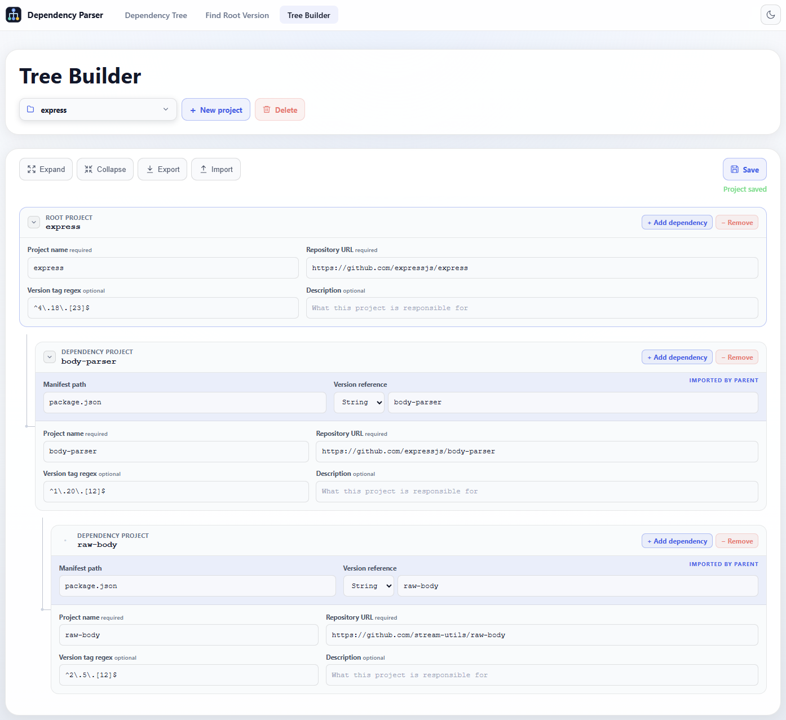
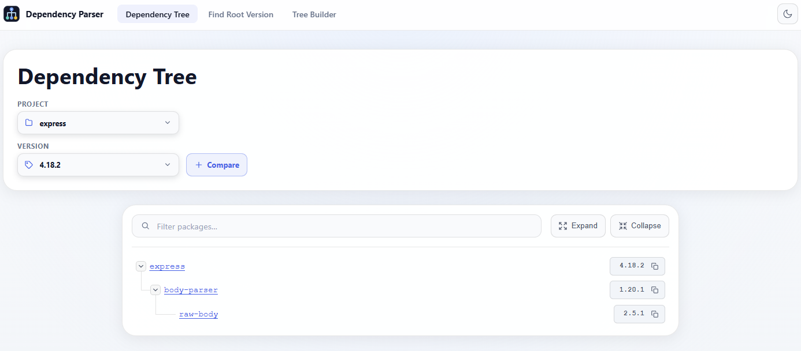
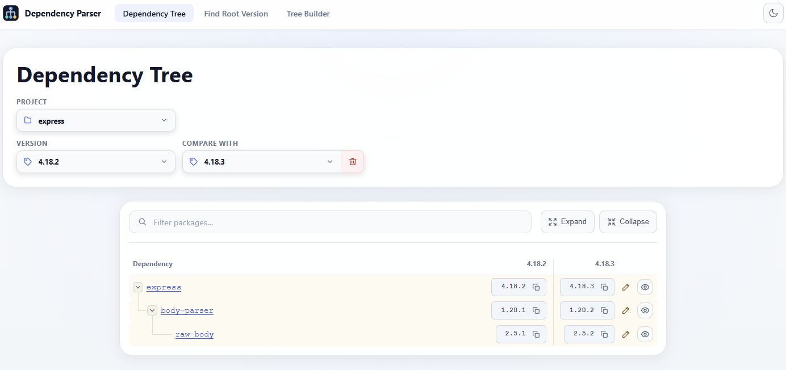
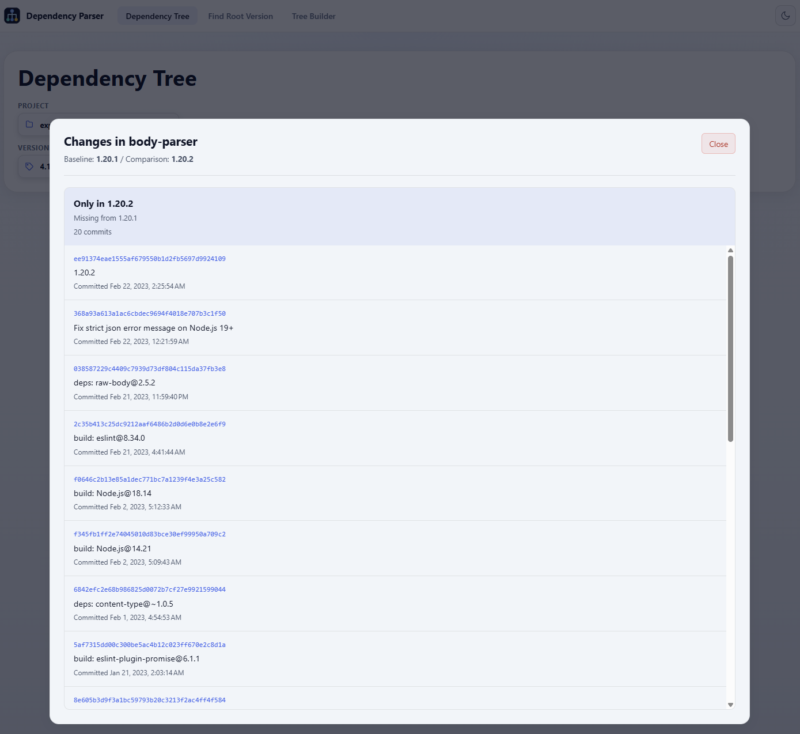
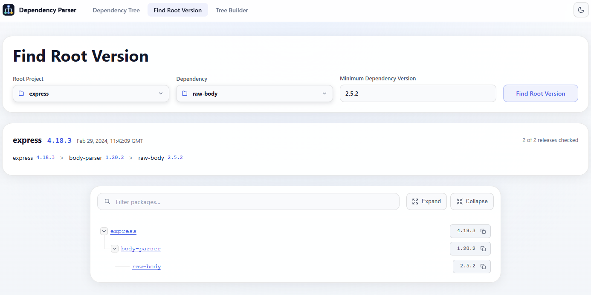

# Demo: Track A Dependency Update With Express

This walkthrough uses real public repositories to answer: **Which Express release includes raw-body `2.5.2`?**

You will configure a project tree, inspect a release, compare two releases, view commit changes, and find the parent release containing an update.

## Before You Start

- Start Dependency Parser using the [local setup instructions](RUNNING.md#build-and-run-locally), then open `http://localhost:4200`. If you use the [test container](RUNNING.md#build-and-run-in-a-container), open `http://localhost:3000` instead.
- The backend needs Git and network access to the three public repositories below. No GitHub token is needed for this public example.
- You do **not** need to install Express or create sample repositories. The tool reads Git tags and manifests, not installed npm packages.

## The Example

Express depends on **body-parser**, which depends on **raw-body**. We will track only these three packages, not every dependency of Express.

| Express release | body-parser version | raw-body version |
| --- | --- | --- |
| [4.18.2](https://github.com/expressjs/express/blob/4.18.2/package.json) | [1.20.1](https://github.com/expressjs/body-parser/blob/1.20.1/package.json) | [2.5.1](https://github.com/stream-utils/raw-body/blob/2.5.1/package.json) |
| [4.18.3](https://github.com/expressjs/express/blob/4.18.3/package.json) | [1.20.2](https://github.com/expressjs/body-parser/blob/1.20.2/package.json) | [2.5.2](https://github.com/stream-utils/raw-body/blob/2.5.2/package.json) |

These are historical releases for inspection, **not versions to install or deploy**. The expected results below are checked against the linked tagged manifests, not an end-to-end application run.

## 1. Configure The Project In Tree Builder

### Fill In The Root Project

1. Open **Tree Builder** (`/builder`).
2. Click **New project**, or **+ Create root project** on the empty screen.
3. Fill in the root card:

| Field | Value |
| --- | --- |
| Project name | `express` |
| Repository URL | `https://github.com/expressjs/express.git` |
| Version tag regex | `^4\.18\.[23]$` |

The regex limits this walkthrough to tags `4.18.2` and `4.18.3`. Copy it without surrounding `/` delimiters. All tags used in this example have **no `v` prefix**.

For your own repositories, the regex is optional: blank includes all tags; `^v\d+\.\d+\.\d+$` includes only `v`-prefixed numeric tags; `^\d+\.\d+\.\d+$` includes only unprefixed ones; `^v?\d+\.\d+\.\d+$` allows both. Allowing both does not make them interchangeable: exact manifest versions and requested tags must keep their original prefix.

### Add The Two Dependencies

1. Click **+ Add dependency** on the **express** card. Fill in the **body-parser** values below.
2. Click **+ Add dependency** on the new **body-parser** card, **not on express**. Fill in the **raw-body** values.

| Field | body-parser card | raw-body card |
| --- | --- | --- |
| Project name | `body-parser` | `raw-body` |
| Repository URL | `https://github.com/expressjs/body-parser.git` | `https://github.com/stream-utils/raw-body.git` |
| Version tag regex | `^1\.20\.[12]$` | `^2\.5\.[12]$` |
| Imported by parent: Manifest path | `package.json` | `package.json` |
| Imported by parent: Version reference type | **String** | **String** |
| Imported by parent: Version reference | `body-parser` | `raw-body` |

**How to read "Imported by parent":**

- **Manifest path** points into the **parent's repository**. For body-parser, that is Express's manifest; for raw-body, it is body-parser's manifest.
- With **String** selected, **Version reference** is the package name in that manifest, not a version number or JSON path.
- Tree Builder only inspects the links you configure. It does not automatically add every package from a manifest.

Click **Save** and wait for **Project saved**. This saves the configuration; the next step resolves its versions and manifests.



## 2. View The Dependency Tree

1. Open **Dependency Tree** (`/tree`).
2. Select **express** in **Project**.
3. Open **Version**, search for `4.18.2`, and select it. The tree loads automatically.
4. Click **Expand** to see both dependency levels.

**Expected tree:**

```text
express 4.18.2
  -> body-parser 1.20.1
       -> raw-body 2.5.1
```

The first request may take longer while the backend retrieves the repositories. If the version list is empty, click **Refresh versions** in the version dropdown.

Use **Filter packages** to find a package. **Collapse** closes the tree and clears the filter. Hover over or focus a version tag to see its date when available.



## 3. Compare Two Express Releases

1. Keep `4.18.2` selected as **Version**.
2. Click **Compare**.
3. In **Compare with**, select `4.18.3`.
4. Review the side-by-side columns: the first is the baseline, and the second is the comparison.

**Expected changes:**

| Package | Baseline | Comparison |
| --- | --- | --- |
| express | `4.18.2` | `4.18.3` |
| body-parser | `1.20.1` | `1.20.2` |
| raw-body | `2.5.1` | `2.5.2` |

This shows both the **direct update** to body-parser and the **nested update** to raw-body. Other comparisons can also show added, removed, and unchanged packages.



## 4. Inspect The Commit Changes

1. On the changed **body-parser** row, click the eye-icon **Show changes** action.
2. Review the commits unique to each version:
   - The baseline area lists commits only in `1.20.1`.
   - The comparison area lists commits only in `1.20.2`.
   - If only one version has unique commits, only that area appears.
3. Click a commit link to open it on GitHub.
4. Close the dialog or press Escape to return.

This is a **Git commit changelog**, not an inline file diff. The action is available on version-changed rows, including the root and nested dependencies, but not on added, removed, or unchanged rows. Tags with identical histories can have no commit differences.



## 5. Find The Express Release Containing The Update

Now answer the original question: **Which Express release includes raw-body `2.5.2`?**

1. Open **Find Root Version** (`/find-root-version`).
2. Complete the form:

   | Field | Value |
   | --- | --- |
   | Root Project | `express` |
   | Dependency | `raw-body` |
   | Minimum Dependency Version | `2.5.2` |

3. Click **Find Root Version**.
4. Review the matching root release, dependency path, releases checked, and full tree.

**Expected match with this configuration:**

```text
express 4.18.3 -> body-parser 1.20.2 -> raw-body 2.5.2
```

In other words, **Express `4.18.3` includes raw-body `2.5.2` through body-parser `1.20.2`**. You can also search for the direct dependency: select body-parser and enter minimum `1.20.2`.

The minimum means **that version or newer**, but the input must name an existing active tag accepted by the dependency's regex. Enter `2.5.2`, not `>=2.5.2` or `v2.5.2`.

**Keep in mind:**

- The search checks configured root tags **newest first by tag date**, returning the start of the latest qualifying release run. It is not necessarily the first-ever historical release containing the update.
- If the newest inspectable release does not qualify, the search returns no match, even if an older release did.
- Open **Warnings (N tags) - View details** if shown. Skipped or unresolved releases can prevent an exact introduction point from being established.
- Returning to this screen can restore a saved result. Run the search again for fresh results; use **Refresh versions** on Dependency Tree first if you need newly published root tags.

See the [search reference](backend/README.md#find-root-version) for the full ordering and warning rules.



## Troubleshooting

| Problem | What to check |
| --- | --- |
| express is missing from other screens | Return to Tree Builder, click **Save**, and confirm **Project saved**. |
| Version list is empty or a tag is missing | Check the repository URL and regex, then click **Refresh versions**. Use the exact unprefixed tags above. |
| A dependency is `unknown` | Check **Manifest path** against the parent repository and **Version reference** against the package name in its manifest. |
| A version is visible, but its children are unresolved | Check that its exact Git tag is accessible. A displayed declaration alone does not prove the dependency repository was inspected. |
| Minimum dependency version is rejected | Use an existing active tag accepted by that dependency's regex, including its exact prefix. |
| Search returns no match | Check the latest inspectable root release against the minimum and read any warnings. |
| Git or network errors appear | Check backend connectivity and repository access before retrying. |

## Use Your Own Repositories

- Replace the project names, repository URLs, and tag patterns. Add only the dependency paths you want to investigate.
- Set each dependency's parent-relative manifest path and package name. Versions in this workflow come from **Git tags**, not branches or hosting-platform release pages alone.
- npm ranges are supported and resolve to the highest compatible configured Git tag. They do **not** reproduce historical npm installs or read lockfiles; see [npm range resolution and cache refresh](backend/README.md#npm-version-ranges).
- For private GitHub repositories, see [token authentication](backend/README.md#github-token-authentication).
- To reuse a configuration, select it in Tree Builder's saved-project dropdown or use **Export**. **Import** replaces the working configuration and still requires **Save**.

For more screen behavior and controls, see the [frontend reference](frontend/README.md#current-screens).
