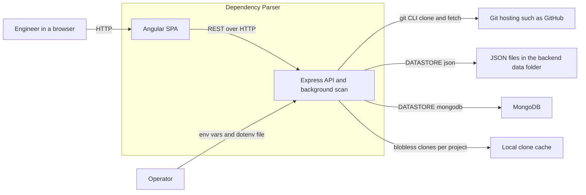
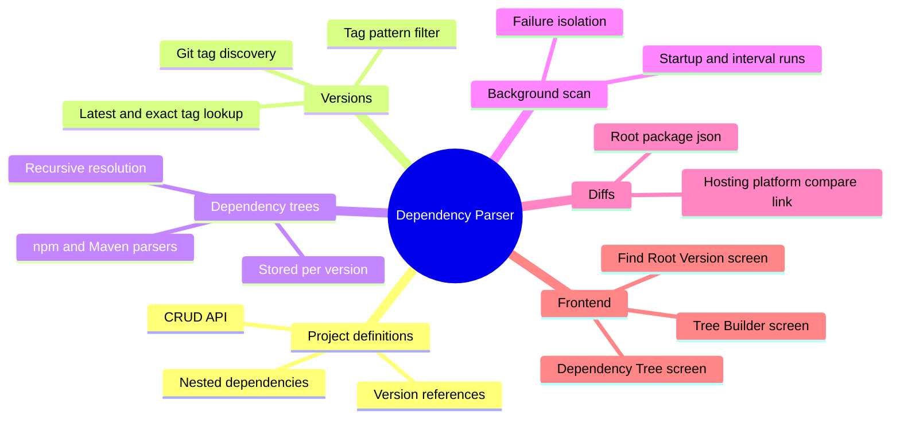
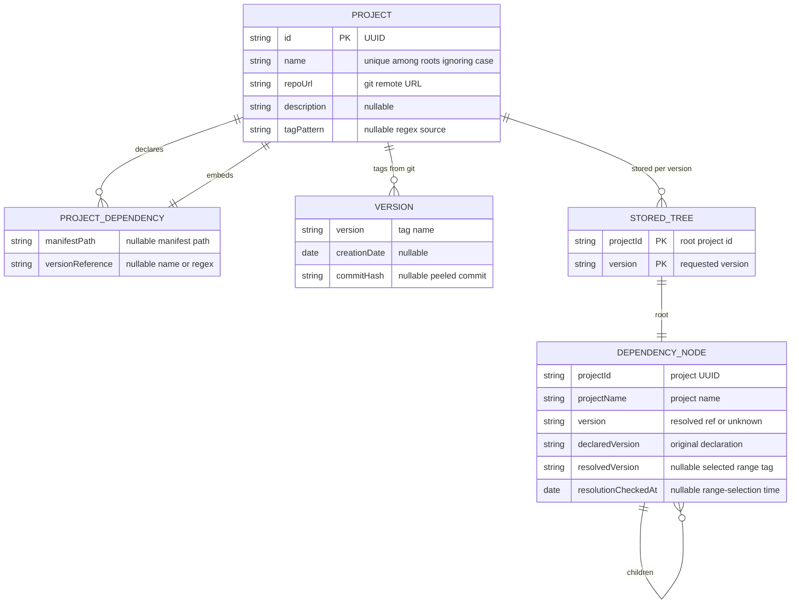
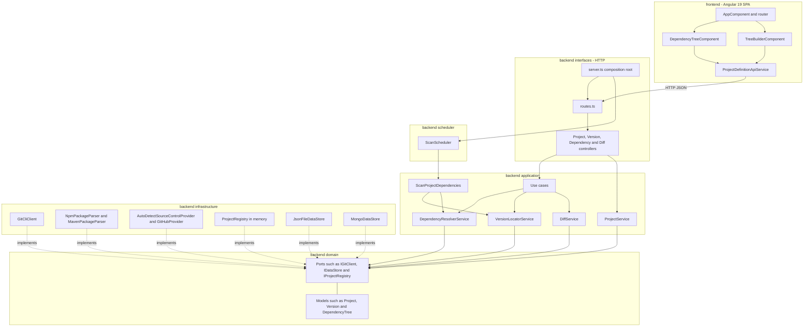
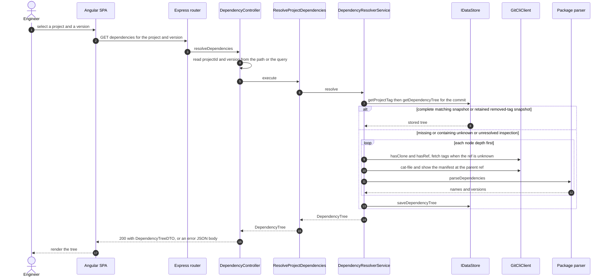
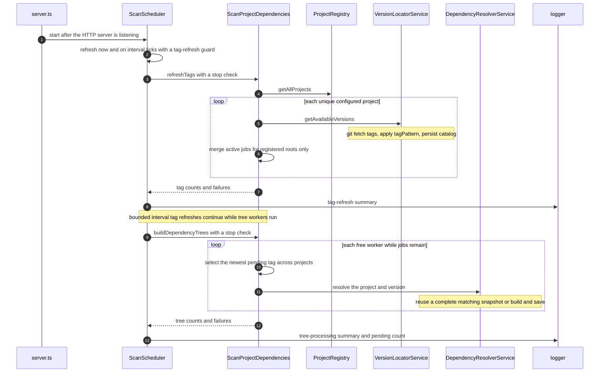
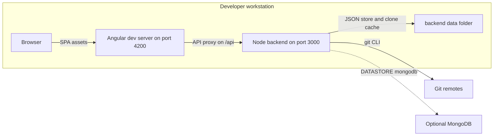

# Dependency Parser: High Level Design

**About this document**

- **What it is:** an as-built design description derived from the code. Where the code does not answer a question, this document says so instead of guessing.
- **Baseline:** the source tree on `main`. This describes the implementation, not a production deployment or release certification.
- **Paths:** repository-relative. Documentation ownership and verification guidance are in [Appendix A](#appendix-a-verification-of-existing-documentation).

---

## 1. Overview

### 1.1 What the system does

Dependency Parser tracks how user-defined software projects depend on each other across releases.

- **Project definitions:** a user defines a root project: a git repository URL, an optional tag pattern, and a nested list of dependency projects. Each dependency names the manifest file (`package.json` or `pom.xml`) and the package entry in it that pins that dependency's version.
- **Version discovery:** the backend persists observed git tags matching the project's pattern, retaining matching removed entries independently of computed trees.
- **Tree resolution:** for any version, the backend builds the transitive dependency tree. It reads each manifest at the parent's tag through the git CLI, recursing level by level.
- **Persistence:** tag catalogs and commit-aware dependency snapshots are stored in JSON files or MongoDB. Active caches respect project configuration; removed versions can use retained snapshots.
- **Diffs:** two versions of a project's root `package.json` can be compared. A separate commit-history comparison returns commits exclusive to each ref for root or nested projects, with browser links selected for the recognized hosting platform.
- **Background scan**: a job runs at startup and on an interval (default 15 minutes). It refreshes complete matching tag catalogs for roots and configured nested dependencies; only registered roots receive independent dependency-tree jobs.
- **Frontend:** an Angular single-page app with three screens. Dependency Tree browses and compares resolved trees. Tree Builder edits the project definitions. Find Root Version locates the start of the latest parent release run containing a dependency minimum.

### 1.2 Tech at a glance

| Area | Technology | Declared version | Source |
| --- | --- | --- | --- |
| Shared runtime | Node.js and npm | Node `^22.22.3 \|\| ^24.15.0 \|\| >=26.0.0`, npm `>=10` | Root `package.json` |
| Backend language | TypeScript, strict, ES2022 library types, compiled to ES2020 / CommonJS in `dist/` | `^6.0.3` | `backend/package.json`, `backend/tsconfig.json` |
| HTTP server | Express 5 with `cors` and `express.json()` | `express ^5.3.0`, `cors ^2.8.6` | `backend/src/interfaces/http/server.ts` |
| Configuration | `dotenv` (`backend/.env`) and environment variables | `^18.0.8` | `server.ts`, `backend/src/utils/logger.ts` |
| Persistence | JSON files or MongoDB, chosen at startup | `mongodb ^7.7.0` | `backend/src/infrastructure/storage/` |
| Manifest parsing | Native JSON for npm; `fast-xml-parser` for Maven | `^5.11.2` | `backend/src/infrastructure/parsers/` |
| Source access | git CLI through `child_process.execFile`, no shell | External binary on `PATH` | `backend/src/infrastructure/git/GitCliClient.ts` |
| Backend development | `tsx watch`, restarting on source changes | `^4.23.15` | `backend/package.json` |
| Backend tests | `node:test` + `node:assert`, run against compiled `dist/` | Built-in | `backend/tests/` |
| Frontend | Angular standalone components and signals, built with `@angular/build` | `^22.2.4` (CLI/build `^22.2.5`) | `frontend/package.json`, `frontend/angular.json` |
| Frontend language | TypeScript, strict templates | `~6.0.3` | `frontend/package.json`, `frontend/tsconfig.json` |
| Frontend tests | Vitest + Playwright, real headless Chromium | Vitest `^5.0.5`, Playwright `^1.64.1` | `frontend/package.json`, `frontend/angular.json` |
| Deployment / CI | GitHub Actions verification, versioned Git tags, downloadable test Docker images; no production deployment | Node.js 24 on Ubuntu and Debian-based Node.js 24 container | See [Section 10](#10-deployment) |

The frontend uses zone-based change detection with event coalescing and the XHR HTTP backend. Browser-based unit tests use Vitest with Playwright. The root, backend, and frontend each retain their own version-controlled npm lockfile; see the [shared installation instructions](../CONTRIBUTING.md#install-and-build) and [dependency maintenance guidance](../CONTRIBUTING.md#maintaining-dependencies).

### 1.3 Context diagram

<!-- Text fallback: the engineer uses the Angular SPA, which calls the Express API. The operator configures the API through environment variables. The API uses the git CLI to clone and fetch from git hosts, keeps blobless clones in a local cache, and persists data to JSON files or MongoDB. -->

The API reaches git hosts only through the git CLI. There are no REST calls to GitHub or any other host API. `AutoDetectSourceControlProvider` builds browser URLs from the repository hostname, reusing `GitHubProvider` for GitHub (`backend/src/infrastructure/providers/`).

Optional GitHub repository credentials are handled separately: `server.ts` validates `GITHUB_TOKEN` through `app.config.ts` and injects it into the shared `GitCliClient`. The infrastructure adapter supplies a process-local, HTTPS GitHub-scoped Authorization header for every Git command, including lazy object fetches. Browser URL providers and the domain interfaces do not handle credentials.

---

## 2. Functional Requirements

The repository has no requirements document. The requirements below describe what the code implements today, so each one points to its source file. IDs are for reference within this document.

  <!-- Text fallback: the capability areas are project definitions, versions, dependency trees, background scan, diffs and the three frontend screens. -->

| ID | Capability | Behaviour as implemented | Source |
| --- | --- | --- | --- |
| FR-01 | Manage project definitions | **Operations:** list, get, create, update and delete root project definitions. **IDs:** create always assigns a fresh UUID to the root; update keeps the ID in the path. Nested IDs are kept only if they are valid, unused UUIDs. **Validation:** root names must be unique ignoring case (409). Direct sibling dependency names must be unique (400). **Persistence:** writes need a persistent datastore; otherwise they return 503. | `backend/src/application/services/ProjectService.ts`, `backend/src/interfaces/http/controllers/ProjectController.ts` |
| FR-02 | Define nested dependencies | A dependency embeds a full project definition plus: **`manifestPath`:** the manifest file. The parser is chosen by file name: `package.json` or `pom.xml`. **`versionReference`:** an exact package name, a `/pattern/flags` string, or a `{pattern, flags}` object. **`tagPattern`:** must compile as a regular expression. | `backend/src/application/dto/ProjectDefinitionDTO.ts`, `backend/src/domain/models/ProjectDependency.ts` |
| FR-03 | Discover versions | **Projects:** roots and configured nested dependencies use their own complete repository tag catalogs, independent of tree contents. **Source:** persisted catalog when scans are enabled and cached versions exist; source retrieval when the cached list is empty, scans are disabled, or `forceRefresh=true`. **Current adapter:** Git; successful refreshes reconcile and persist matching tags. **History:** missing matching tags are marked removed only after a successful full refresh. **Filter and order:** filtered by `tagPattern`, sorted by Git date and numeric tag name. `latest` is the first active entry. | `backend/src/application/use-cases/GetDependencyVersion.ts`, `backend/src/application/services/VersionLocatorService.ts`, `backend/src/interfaces/http/controllers/VersionController.ts` |
| FR-04 | Resolve a requested version | Accepts an exact tag name or `latest`. Prefixed and unprefixed names remain distinct; no `v` prefix is added or removed. Returns 404 when nothing matches. | `VersionLocatorService.resolveVersion`, `VersionController.getVersion` |
| FR-05 | Resolve a dependency tree | Builds the tree for one project and version. **Recursion:** it follows the defined dependencies. Each child's declaration is read at the parent's ref; npm SemVer ranges select the highest compatible configured Git tag before recursion. **Cycles:** guarded by tracking `projectId@version` ancestry. **Unreadable versions:** a child whose version cannot be read becomes `unknown`. | `backend/src/application/services/DependencyResolverService.ts`, `NpmPackageParser.ts` |
| FR-06 | Store and reuse trees | **Storage:** snapshots are keyed by root project, version, and commit hash. **Reuse:** active trees must match the project configuration and resolution-policy fingerprint; npm range selections expire after a configurable TTL, default one day. **Retention:** configuration or policy changes invalidate active reuse without deleting history; removed tags use retained snapshots without TTL expiry. | `DependencyResolverService.ts`, `backend/src/infrastructure/storage/JsonFileDataStore.ts`, `backend/src/infrastructure/storage/MongoDataStore.ts` |
| FR-07 | Background dependency scan | **When:** refresh tags at startup and every `DEPENDENCY_SCAN_INTERVAL_MINUTES` (default 15), independently of tree processing. **What:** refresh each unique root/dependency catalog once, including nested descendants and tags never referenced by trees; only active registered-root versions enter the deduplicated tree queue. Free tree workers select newest pending tags. **Guards:** one refresh pass and one bounded tree pool, with a shared Git-command cap; shutdown awaits both. **Failures:** isolate project/tag failures; failed Git refreshes do not change removal flags. | `backend/src/scheduler/ScanScheduler.ts`, `backend/src/application/use-cases/ScanProjectDependencies.ts`, `backend/src/config/app.config.ts` |
| FR-08 | Compare package versions | Reports added, removed and updated entries of the root `package.json` `dependencies` between two refs. Also returns a hosting-platform compare URL for recognized repository hosts. | `backend/src/application/services/DiffService.ts`, `backend/src/application/use-cases/ComparePackageVersions.ts`, `backend/src/infrastructure/providers/AutoDetectSourceControlProvider.ts` |
| FR-09 | Health endpoint | `GET /api/health` always returns `{"status":"ok"}`. | `backend/src/interfaces/http/routes/routes.ts` |
| FR-10 | Dependency Tree screen | **Selection:** pick a project and version; each version picker opens scrolled to its selected tag within up to 200 options. Searching shows the first 200 matches. **View:** view the resolved tree. **Comparison:** compare with a second version, merged client-side and marked changed, added or removed. **Tools:** filter, expand and collapse, copy a version, open repository links. **Memory:** the last selection is remembered. | `frontend/src/app/dependency-tree/dependency-tree.component.ts`, `frontend/src/app/dependency-tree/dependency-tree.models.ts` |
| FR-11 | Tree Builder screen | **Editing:** create and edit nested project definitions, with a draft per project kept in browser storage. **API:** save, update and delete through the API. **Files:** import and export JSON. | `frontend/src/app/tree-builder/tree-builder.component.ts`, `frontend/src/app/tree-builder/tree-builder.models.ts` |
| FR-12 | Theme | Toggles between dark and light themes, stored in `localStorage` under `dep-dashboard-theme`. | `frontend/src/app/app.component.ts` |
| FR-13 | Find Root Version | **Validation:** refresh all regex-matching tags of the selected dependency; require an active exact or `v`-alias minimum before any root scan. **Search:** inspect root tags by descending date with numeric tie-breaking; retain matching trees and stop at the first confirmed non-match. Undated tags follow dated tags. **Comparison:** dependency digits are read left to right, ignoring labels and capture nesting. **Result:** start of the latest inspectable matching run, full tree, path and attempted-release counts. **Failure:** missing minimum tags are input errors; retrieval failures remain fatal. During the historical scan, log and skip missing refs and undecidable relevant unknown trees; other resolution failures remain fatal before the boundary. | `backend/src/application/use-cases/FindRootVersion.ts`, `frontend/src/app/find-root-version/find-root-version.component.ts` |
| FR-14 | Commit changelog | **Action:** an eye icon with a Show changes hover hint on version-changed root and dependency rows, never added/removed/unchanged rows. **Comparison:** actual Git reachability, with full hashes, subjects, and commit links; shared history is excluded. **Popup:** baseline-only commits on the left and comparison-only commits on the right, one full-width area for one-sided differences, and an empty state for identical histories. Loading, retry, keyboard focus containment, Escape, and stale-request cancellation are supported. | `backend/src/application/use-cases/CompareVersionCommits.ts`, `backend/src/infrastructure/git/GitCliClient.ts`, `frontend/src/app/dependency-tree/commit-diff-dialog.component.ts` |

---

## 3. Non-functional Requirements

The [security policy](../SECURITY.md) defines supported revisions and private vulnerability reporting. The repository declares no SLOs or performance budgets beyond the frontend bundle budgets in `frontend/angular.json`. Each subsection describes what the code does today and the gaps that follow from it.

### 3.1 Security

**As built:**

- **Git commands:** they run through `execFile` with no shell, so there is no shell injection. Git refs that are empty or start with `-` are rejected (`GitCliClient.assertSafeRef`). Manifest paths cannot escape the clone folder (`GitCliClient.resolveRepoFilePath`).
- **Input validation:** request bodies are validated field by field in `ProjectDefinitionDTO.toDomain`. A `tagPattern` or `versionReference` that is not a valid regular expression is rejected.
- **Secrets:** `MONGODB_URI` and optional `GITHUB_TOKEN` come from the environment or the gitignored `backend/.env`. Startup logs record the datastore type, a boolean `githubTokenConfigured`, and an info message identifying whether GitHub HTTPS access uses `GITHUB_TOKEN` or default Git authentication, never the token value (`server.ts`). This reports configuration, not successful authentication; SSH and other hosts retain default Git authentication.
- **GitHub repository authentication:** with Git 2.31+, `GitCliClient` appends URL-scoped `http.https://github.com/.extraHeader` entries through `GIT_CONFIG_COUNT`/`KEY`/`VALUE` environment variables, preserving other process configuration and resetting inherited headers at this scope before applying Basic credentials. The token is not added to URLs, command arguments, or saved Git configuration. Raw and Basic-encoded configured credentials are redacted from Git command errors. Unset/blank tokens preserve existing behavior. This is a shared backend credential, not user authorization; see the [backend setup](../backend/README.md#github-token-authentication).

**Gaps:**

- **No end-user authentication or authorization:** `server.ts` and `routes.ts` do not configure user-authentication or role middleware for the HTTP API. Operators must implement and maintain these controls in their own extension or fork before exposing the application to untrusted users; see [deployment responsibilities](../CONTRIBUTING.md#deployment-responsibilities). Optional `GITHUB_TOKEN` authentication only supplies backend Git repository credentials; it does not protect incoming API requests.
- **CORS is open to every origin:** `app.use(cors())` uses default options.
- **No protective middleware:** there is no rate limiting, security-header middleware or request-size configuration beyond Express defaults.
- **`repoUrl` reaches git as an argument with no `--` separator:** it is only checked for being non-empty, then passed to `git clone` (`GitCliClient.clone`, `GitCliClient.syncRepositoryTags`). A value starting with `-` would be read as a git option (argument injection, CWE-88 class). Local paths and `file://` URLs are also accepted.
- **User-supplied regular expressions run on the server:** `tagPattern` and `versionReference` are only checked for compiling, so a crafted pattern can cause catastrophic backtracking (ReDoS).
- **Raw Git diagnostics:** several controllers send `{ "error": message }`, which for Git failures includes the command and its stderr. The configured `GITHUB_TOKEN` is redacted in raw and Basic-encoded forms, but unrelated credentials embedded in a `repoUrl` can still appear in responses and error logs.
- **Other Git credentials come from the host:** without `GITHUB_TOKEN`, or for other hosts/transports, the host's Git configuration supplies credentials. Git still runs with no timeout and does not disable terminal prompts, so a missing credential can block a request or a scan.

### 3.2 Performance

**As built:**
- **Stored trees:** a matching complete snapshot is returned without git access; removed tags can use retained historical snapshots (`DependencyResolverService.resolve`).
- **Version retrieval:** new catalogs with selective project patterns on Git 2.45+ select remote tag refs before depth-1 transfer and batch reftable updates atomically; unchanged tag objects are not fetched again. Full-tag packed-clone compatibility is automatic for unsupported Git, unfiltered/all-matching initial catalogs, and existing full caches. The Git adapter owns selection/fallback; server construction and environment settings are unchanged.
- **Shared cache compatibility:** version discovery retains the original per-project cache path. The dependency resolver reuses exact known refs and requests an unfiltered sync for missing refs. That sync expands a selective catalog to full branch/tag history and default-branch/HEAD state; no targeted source-fetch or manifest-reuse optimization is applied.
- **Clone-filter trade-off:** `blob:none` retains directory trees, avoiding additional on-demand tree downloads during manifest reads. A local cold-import comparison found `tree:0` slower for both tag discovery and first-tree resolution on the evaluated repository, despite reducing the initial object download; that experimental filter is not used. Existing clone filters are not migrated.
- **MongoDB tag persistence:** reconciled tag upserts and excluded-tag deletions use a bulk write, avoiding a database round trip for every tag while retaining the same metadata and removal semantics (`MongoDataStore.syncProjectTags`).
- **Deduplicated version listings:** concurrent listings for the same project share one request (`VersionLocatorService.inFlightRequests`).
- **Frontend:** the Dependency Tree screen makes one version-list request per selected project. Each version dropdown has an explicit source-refresh action (`dependency-tree.component.ts`).
- **Newest-run search:** sorts root tags by descending date with numeric tie-breaking and inspects one tree at a time through the first confirmed non-match, skipping missing refs and undecidable relevant unknown trees. It shares scan-aware cached listing with the version endpoint and reuses complete resolver snapshots. Older trees beyond the boundary are never resolved. A newest inspectable non-match needs only one tree; when all releases qualify or are skipped, every release is attempted.

**Gaps:**
- **Sequential tree building:** children are resolved one after another. Reading each manifest from a blobless clone downloads the blob on demand over the network.
- **Source refresh cost:** `GET .../versions` refreshes Git when scanning is disabled, `forceRefresh=true`, or the scan-enabled catalog is empty. Selective catalogs require a complete ref advertisement and fetch changed matching objects; the compatibility strategy fetches all tag refs. Nonempty scan-enabled listings reuse the stored catalog.
- **Diffs:** each `GET .../diffs` makes a full, non-blobless clone into the OS temp folder, checks out both refs, then deletes the clone (`DiffService.compareVersions`).
- **JSON store cost:** every JSON-store operation reads and parses the whole file, and every write rewrites it. Cost grows with the number of stored trees.
- **Recomputation:** explicit requests can retry unresolved inspection. npm range selections, including no-match results, remain cached until their TTL expires. Automatic scans skip current saved snapshots and remember successful jobs, but requeue range-containing trees after expiry.

### 3.3 Reliability

**As built:**
- **Startup fails fast on invalid configuration:**
  - an unknown `DATASTORE`, or `DATASTORE=mongodb` without `MONGODB_URI`
  - an invalid `DEPENDENCY_SCAN_*` value
  - a `GITHUB_TOKEN` containing embedded whitespace or control characters
  - a MongoDB connection failure; the server-selection timeout is 10 s (`MongoDataStore.connect`)
- **Startup errors:** they are logged and set exit code 1 (`backend/src/index.ts`).
- **Graceful shutdown:** `SIGINT` and `SIGTERM` stop the timer and start closing the HTTP server. No further queued trees start; both the active tag refresh and current tree resolution are awaited before closing the datastore (`server.ts`, `ScanScheduler`).
- **Scan robustness**: tag refreshes continue during tree work, with separate overlap guards. Project/tag failures are isolated. Failed tree jobs have three total attempts per unchanged tag/configuration per session, scheduled on later refreshes. Pending, active, and completed work is deduplicated by project, tag, commit, and nested project configuration; current saved snapshots are skipped, while expired npm range trees become eligible again (`ScanScheduler`, `ScanProjectDependencies`).
- **JSON store**: operations are serialized through an in-process queue (`JsonFileDataStore.enqueueOperation`).

**Gaps:**
- **No general Git timeouts/backoff or in-flight cancellation at shutdown.** Confirmed missing dependency refs have bounded retries; authentication/network failures and root refs do not use that retry/fallback policy.
- **JSON writes are not atomic:** a plain `writeFile`, with no temporary file and rename, so a crash mid-write can leave a truncated file. A corrupt `projects.json` makes startup fail.
- **Uninspectable versions are not recovered from source:** confirmed missing dependency refs produce partial trees with preserved declared versions and unknown descendants; they do not make those refs inspectable. Root-ref and other resolution failures still fail normally. A removed root tag without a saved snapshot cannot be resolved; retained snapshots are not a source archive.
- **Registry loaded once:** the project list is read from the datastore only at startup. Edits made directly to the store need a restart.
- **The health check is static:** `/api/health` does not check the datastore or git.
- **Invalid `LOG_LEVEL` crashes at import:** the logger is created when its module loads (`backend/src/utils/logger.ts`), so the failure is an uncaught exception. It never produces the "Failed to start server." log line.

### 3.4 Scalability

Everything runs in a single Node.js process. The project registry, request deduplication, git queues and the scheduler all live in memory. See [Section 5](#5-scalability) for limits and options.

### 3.5 Observability

**As built**:
- **Logger:** a console logger with an ISO timestamp, a level prefix and an optional context object. Level comes from `LOG_LEVEL` (`error`, `warn`, `info`, `debug`; default `info`).
- **Streams:** `info` and `debug` go to stdout, `warn` and `error` to stderr. The logger calls `console.info`, `console.debug`, `console.warn` and `console.error`.
- **What gets logged:** server listening and shutdown, registry size and datastore type, scan scheduling, each failure, and separate phase summaries. Each summary carries `phase` (`tags` or `trees`), `status`, `durationMs`, `projectCount`, `tagCount`, `resolvedTreeCount`, `failureCount`, `pendingTreeCount`, `activeTreeCount`, and `maximumConcurrency`.
- **Per-tree events:** debug start/completion/failure includes project, tag, `creationDate` (the priority timestamp as an ISO string or null), commit hash, active/pending counts, and duration on end events. Failed jobs carry the same date and their original exception and emit an immediate error-level log; phase completion suppresses duplicates. Overlapping starts show concurrent tree jobs, including jobs waiting for I/O; MongoDB write arrival order alone is not a concurrency measure.
- **Root-version boundary:** the final non-match debug entry includes the inspected root release, first target-dependency version (or null if absent), and retained matching candidate. See [Find Root Version](../backend/README.md#find-root-version) for decision fields and summary logging.

**Gaps:**
- **No request logging:** no access logs or correlation IDs, and errors handled in controllers are returned to the client but never logged.
- **No metrics, tracing or alerting.**
- **Not machine-parseable:** log lines are text with a context object, not structured JSON.

### 3.6 Portability

**As built:**
- **Runtime needs:** Node.js and a git CLI on `PATH`.
- **Cross-platform behaviour:** paths go through `node:path`, and git runs with `windowsHide: true`.
- **Clone location:** configurable with `CLONE_ROOT`.
- **Test container:** the multi-stage root Dockerfile packages the compiled backend and Angular browser build with Node.js 24, Git, and an SSH client. The non-root process has a fixed backend working directory and a mountable data directory.
- **Dependency installation:** all three npm lockfiles are committed; container builds use each application's lockfile and the public npm registry.
- **Frontend API origin:** browser requests use `/api`; Angular's development proxy forwards them locally, while the combined image serves both applications on one origin.

**Gaps:**
- **Data paths depend on the working directory:** the JSON store files and the default clone root resolve against it (`server.ts`), so the backend must be started from `backend/`.
- **Production hardening:** container base images follow the Node.js 24 tag rather than an immutable digest; secured deployment and registry publishing remain undefined.

### 3.7 Compatibility

- **Manifests:**
  - `package.json` with only `dependencies` read (`NpmPackageParser`).
  - `pom.xml` with `<properties>` and `<dependencies>`, resolving `${...}` placeholders, including `project.*` and `pom.*` with a fallback to `<parent>` (`MavenPackageParser`). Profiles, plugins and `dependencyManagement` are not read.
  - Any other manifest name fails with "No parser available" (404).
- **Repository hosts:**
  - Clone and fetch work with any remote the git CLI can reach.
  - Optional `GITHUB_TOKEN` authentication covers HTTPS `github.com` remotes with Git 2.31+; SSH, HTTP, GitHub Enterprise Server, and other hosts retain existing host-provided Git authentication.
  - Commit, compare, browse, and file URLs automatically recognize exact hosts `github.com`, `gitlab.com` (including nested groups), and `bitbucket.org`. Other hosts beginning with `bitbucket.` and a non-empty suffix use Bitbucket Server/Data Center formats. Detection ignores case and checks Cloud before Server; it selects link formats, not trusted hosts. HTTPS/SSH clone addresses are normalized without changing Git transport; unsupported hosts fail explicitly when constructing links.
- **API:**
  - There is no version prefix (`/api` only).
  - The frontend TypeScript interfaces mirror the backend DTOs by hand (`project-definition-api.service.ts`), so the two can drift apart silently.
- **Stored data:**
  - Both stores share one serialization format (`DataStoreSerialization.ts`). Regular expressions are stored as `{pattern, flags}`.
  - There is no migration between JSON and MongoDB.
- **Browsers:** the supported browser range is not configured in the files reviewed, so Angular CLI defaults apply.

---

## 4. Estimations

The repository contains no load figures, measurements or capacity targets. The estimates below come from the code paths. The only data point is a local, gitignored development datastore, and it is labelled as such. Treat every number here as an illustration to replace with measurements.

### 4.1 Load pattern

- **HTTP traffic:** an internal tool used interactively. Opening a project in the Dependency Tree screen sends up to three requests:
  - the project list
  - one version list, with its source selected by backend scan configuration
  - the selected version's tree
  - a fourth request when a comparison version is chosen; each explicit version refresh adds one listing request
  - one commit-diff request only when the Show changes eye button is activated; a result-cache hit avoids Git, while a miss reuses isolated repository history instead of cloning for each tag pair
- **Background load**: tag refresh at startup, then every `DEPENDENCY_SCAN_INTERVAL_MINUTES` (default 15, up to 96 scheduled attempts a day). Tree processing does not skip these attempts; only an active tag-refresh pass suppresses another pass. Bounded tree workers drain pending jobs independently.

### 4.2 Concurrency

- **HTTP:** one Node.js process, and requests are served concurrently on its event loop.
- **Scan:** one tag-refresh pass and one tree-worker pool run concurrently. Each pool has up to `GIT_MAX_CONCURRENCY` workers (default 4); tree workers can process different versions of the same project. Free workers take the newest pending jobs across projects. A shared Git limiter caps active application-launched commands across both pools and API requests, not separately per pool.
- **Serialization points:**
  - `syncTags` per clone folder (`GitCliClient.tagSyncQueues`)
  - exclusive repository mutations versus shared reads (`GitCliClient.repositoryLocks`)
  - all application-launched Git commands through the shared client's FIFO limiter
  - missing-clone/ref preparation per clone folder (`DependencyResolverService.cloneQueues`); ready-clone checks run concurrently
  - version listing per project (`VersionLocatorService.inFlightRequests`)
  - JSON-store operations per store instance
- **Not serialized:**
  - Two resolutions of the same project and version, for example an HTTP request and the scan. Both compute and save; the last write wins.
  - Revision-pinned read commands can run together, but explicit clone/fetch/ref mutations exclude readers of that clone. Git's internal lazy blob fetches remain inside the bounded application command slot; the cap is not an exact network-connection limit.

### 4.3 Data volume

Notation:
- `P` = root projects
- `C` = unique configured projects, including roots and nested dependencies
- `T` = tags per project after the `tagPattern` filter
- `N` = nodes per tree (defined projects in the definition)

| Item | Growth | Notes |
| --- | --- | --- |
| Stored trees | `P x T` | Nested projects never get their own stored tree; they exist only inside their root's tree. |
| Tree size | about `N x` 100 to 200 bytes | One node holds a 36-character UUID, a name, a version and a child list. The JSON store adds 2-space indentation. |
| JSON tree file | `P x T x N x` bytes per node | The whole file is read on every operation and rewritten on every save. |
| Tag catalog and historical snapshots | Matching tags across `C` projects, plus distinct saved root commits | Catalogs include unreferenced dependency tags. Matching tags survive removal; pattern changes remove excluded catalog entries but retain saved trees. No automatic snapshot retention limit is configured. |
| Git cache | One shared blobless cache per defined project, nested ones included | Stored at `<CLONE_ROOT>/<sanitized project id>`; a selective catalog can expand to a full cache for compatible source resolution. |
| Commit-comparison runtime cache | At most 1,000 completed project/repository/ref pairs per process | Results expire 24 hours after completion; least-recently-used eviction bounds entry count, not total bytes. Reverse directions share an entry. |
| Commit-comparison history cache | Up to 8 retained repository URLs per process; active work may temporarily exceed this count | Tag-scoped, adaptively deepened commit-only histories in OS temporary directories, separate from scan caches. Idle LRU eviction and normal shutdown delete directories; this is not a byte limit. |

- **Local sample** (gitignored `backend/data/`, not part of the repository):
  - 1 root project with 12 stored versions
  - `dependency-trees.json` = 9,159 bytes, about 0.76 KB per tree
  - `projects.json` = 1,849 bytes
- **Illustration only:** 50 roots x 100 tags x 20 nodes x 150 bytes is about 15 MB of JSON. At that size every tree save would rewrite 15 MB, which argues for MongoDB, where each project and version is its own document.

### 4.4 Dominant costs

1. **Network git work:**
  - one complete remote tag-ref advertisement plus changed selected-tip objects for an optimized catalog refresh; a full packed clone/tag-only fetch remains the compatibility path
  - full-cache preparation on the existing dependency-resolution path when a ref is missing
   - a full temporary clone per package-manifest diff; commit changelogs fetch selected tag refs and deepen their ancestry only when completeness requires it
   - an on-demand blob download for each manifest read
2. **Sequential tree building:** each node can trigger `rev-parse`, a fetch when the ref is missing, then `cat-file` and `show`.
3. **JSON store:** a whole-file parse per read and a whole-file rewrite per write.
4. **Disk:** the shared clone cache, bounded commit-history repositories, and temporary package-manifest/general-ref comparison clones.

### 4.5 Latency

No latency targets exist. The table below gives qualitative expectations based on what each path does.

| Path | Expected latency driver |
| --- | --- |
| Tree for a version with a matching complete snapshot | Catalog/configuration and snapshot reads, with no git |
| Tree that is not stored yet, or is incomplete | Network fetches plus one read per node, in sequence, so seconds or more depending on depth and network |
| `GET .../versions` with scans enabled and a nonempty cached list | Persisted catalog and snapshot availability reads; no git |
| `GET .../versions` with an empty cached list, scans disabled, or `?forceRefresh=true` | One `git fetch`, then catalog reconciliation and snapshot availability reads |
| `GET .../diffs/...` | A full clone of the repository |
| `GET .../commit-diffs` | Memory lookup on a result-cache hit; otherwise exact catalog hints or remote discovery, a selected-tag fetch, batched local ref resolution and traversal, plus adaptive deepening only if needed. Concurrent requests for the same pair share the operation. |
| Scan pass | One source refresh per unique root or configured dependency (`C`); only eligible root versions add cold tree resolutions. |

---

## 5. Scalability

**Current model:** a single process that can only scale vertically. Nothing in the repository coordinates multiple backend instances.

| Bottleneck | Why | Source |
| --- | --- | --- |
| In-memory project registry | Loaded once at startup. Create, update and delete calls change only the local instance's copy. | `server.ts`, `backend/src/infrastructure/registry/ProjectRegistry.ts`, `ProjectService.ts` |
| JSON datastore | Whole-file rewrites, and only one process can use it safely, since the queue is in-process. | `JsonFileDataStore.ts` |
| Scheduler per process | Every instance with scanning enabled runs its own full pass. | `ScanScheduler.ts`, `server.ts` |
| Bounded tree resolution | Up to `GIT_MAX_CONCURRENCY` background trees, with newest-first selection for free workers and a shared Git-command budget. Node recursion within each tree remains sequential. | `ScanProjectDependencies.ts`, `DependencyResolverService.ts`, `GitCliClient.ts` |
| Local clone cache | Kept per host, and grows with the number of defined projects. | `DependencyResolverService.ensureClone`, `VersionLocatorService.getClonePath` |

**Running more than one instance today:**
- **Persistence:** use MongoDB. Per-document upserts and unique indexes on `{projectId, name}` for tags and `{projectId, version, commitHash}` for snapshots prevent duplicate identities. Concurrent scans across processes are still not coordinated.
- **Scanning:** enable it on one instance only, as the README advises, by setting `DEPENDENCY_SCAN_ENABLED=false` on the others.
- **Project list:** instances still don't see each other's project changes until they restart, because the registry is in memory.

**Options for later (not implemented):**
- Read the registry from the shared store on each request, or refresh it.
- Elect a single scanner instance, or move scanning to a dedicated worker or durable queue.
- Tune the existing bounded worker pools and shared Git limit for the host and Git server before increasing process count.
- Put git timeouts in place, and record scan status so that items failing again and again back off.

---

## 6. Out of Scope

End-user authentication and authorization are operator-owned responsibilities, implemented in an extension or fork rather than supplied by the base application. The other entries below describe current implementation limits, not delivery commitments.

| Area | Status | Evidence |
| --- | --- | --- |
| End-user authentication and authorization | Operator-owned extension or fork | No user-authentication or role middleware in `server.ts` or `routes.ts`; see [deployment responsibilities](../CONTRIBUTING.md#deployment-responsibilities) |
| Multi-tenancy | Not implemented | No tenant middleware in `server.ts` or `routes.ts` |
| Resolving third-party package graphs from the npm registry or Maven repositories | Not implemented | The resolver follows only dependencies declared in project definitions. Parsed manifest entries are used only to look up a declared dependency's version (`DependencyResolverService.readDependencyVersion`). |
| npm `devDependencies`, `peerDependencies`, lockfiles, registry tags/aliases and local/workspace/Git specifications | No ecosystem-specific resolution | `NpmPackageParser` reads `dependencies` only. SemVer ranges are resolved against configured Git tags; non-SemVer specifications retain literal-ref behavior. |
| Maven profiles, plugins, `dependencyManagement`, remote parent POMs | Not read | `MavenPackageParser.ts` |
| Manifests other than `package.json` and `pom.xml` | Not supported | Each parser's `supports()` method |
| Diffs for Maven or for manifests other than the root `package.json` | Not implemented | `server.ts` builds `DiffService` with `NpmPackageParser` and `"package.json"` |
| Showing root package-manifest diff results in the frontend | Not implemented | The frontend never calls `/diffs`; commit changelogs use the separate `/commit-diffs` endpoint (`project-definition-api.service.ts`) |
| Arbitrary self-hosted domains and custom browser-link templates | Not implemented | `AutoDetectSourceControlProvider` recognizes only the four documented hosts. No host probing, domain-name heuristics, or configurable templates are used. |
| CLI interface | Not implemented | There is no `backend/src/interfaces/cli/` |
| Durable or distributed jobs, scan history and status, an API to trigger a scan | Not implemented | `ScanScheduler` is an in-process timer, and scan results are only logged |
| Metrics, tracing, alerting | Not implemented | Only `backend/src/utils/logger.ts` exists |
| Test container images and matching Git tags | Implemented through CI artifacts; no registry publishing | See [Section 10](#10-deployment) |
| Helm charts and production deployment | Not implemented | See [Section 10](#10-deployment) |
| `.github/` Copilot customizations and AI-DLC files | Developer tooling, not part of the running system | `.github/agents/`, `.github/skills/` |

### Remaining Work

- Replace the dashboard mock snapshot with data loaded from the backend API.
- Display backend package-manifest diff results alongside the existing dependency-tree comparison and commit changelogs.
- Improve validation and error handling for repository availability, unsupported manifests, malformed project definitions, and additional source-control hosts.
- Define production deployment, TLS, secret delivery, and datastore backup/recovery beyond the test Docker image and downloadable CI artifacts.

These are current gaps, not committed delivery dates or exclusions. See [deployment gaps](#104-gaps-to-close-before-a-shared-or-production-deployment) for operational considerations and [contribution rules](../CONTRIBUTING.md#github-contribution-rules) before proposing work.

---

## 7. Entities and Core APIs

### 7.1 Entity relationships

<!-- Text fallback: a project declares project dependencies, and each dependency embeds a full nested project. A project has versions discovered from git tags and stored trees keyed by root project id and version. A stored tree has one root dependency node, and each node has child nodes. -->

**Notes:**
- **Nested projects are embedded:** they live inside their root's definition (`ProjectDependency.project`), not in separate registry entries. Only root projects can be fetched by ID through the API, and only roots are scanned.
- **Persistent tags:** `ProjectTag` is stored independently of trees, keyed by project ID and tag name. `Version` is the catalog-backed listing view. The diagram abstracts snapshot commit identity; the full key is project ID, version, and commit hash.
- **Node identity:** a node's derived ID is `projectId@version` (`DependencyNode.id`), and `DependencyTree.flatten` uses it to remove duplicates.

### 7.2 Entity fields and transient types

| Type | Fields | Source |
| --- | --- | --- |
| `Project` | `id`, `name`, `repoUrl`, `description`, `dependencies` (array or null), `tagPattern` | `backend/src/domain/models/Project.ts` |
| `ProjectDependency` | `project` (nested `Project`), `manifestPath`, `versionReference` (string, RegExp or null) | `backend/src/domain/models/ProjectDependency.ts` |
| `Version` | `version`, `creationDate`, `commitHash`, `removed`, `hasDependencyTree` | `backend/src/domain/models/Version.ts` |
| `ProjectTag` | `projectId`, `name`, `commitHash`, `creationDate`, `removed` | `backend/src/domain/models/ProjectTag.ts` |
| `DependencyTree` | `root`, plus the traversal helpers `findByProjectId`, `find`, `flatten`, `contains` | `backend/src/domain/models/DependencyTree.ts` |
| `DependencyNode` | `projectId`, `projectName`, `version`, `dependencies`, `dependenciesResolved` (defaults true), `declaredVersion`, nullable `resolvedVersion` and `resolutionCheckedAt` | `backend/src/domain/models/DependencyNode.ts` |
| `Dependency` (a parsed manifest entry) | `name`, `version` | `backend/src/domain/models/Dependency.ts` |
| `ParseResult` | `dependencies`, `metadata.packageManager`, `metadata.raw` | `backend/src/domain/types/ParseResult.ts` |
| `DiffResult` / `DependencyChange` | `added`, `removed`, `updated`, each a list of `{name, fromVersion, toVersion}` | `backend/src/domain/types/DiffResult.ts` |
| `DependencyScanResult` *(logged only)* | `projectCount`, `tagCount`, `resolvedTreeCount`, `failures` (`projectId`, optional `version`, `error`) | `backend/src/application/use-cases/ScanProjectDependencies.ts` |

### 7.3 Persistence mapping

| Store | Projects | Trees | Source |
| --- | --- | --- | --- |
| `DATASTORE=json` | `<cwd>/data/projects.json`: `{ "projects": { "<rootId>": SerializedProject } }` | `<cwd>/data/dependency-trees.json`: version-keyed snapshot arrays containing `root`, `commitHash`, and `projectConfiguration` | `server.ts` (`buildDataStore`), `JsonFileDataStore.ts` |
| `DATASTORE=mongodb` | Collection `projects`: a `SerializedProject` with `_id` set to the project ID | Collection `dependencyTrees`: `projectId`, `version`, `root`, `commitHash`, `projectConfiguration`, `savedAt`; unique project/version/commit index | `MongoDataStore.ts` |
| Unset, empty or `memory` | Nothing is stored and the registry starts empty | Nothing is stored or reused | `server.ts` |

Both stores share one serialization format, defined in `backend/src/infrastructure/storage/DataStoreSerialization.ts`. Regular-expression version references are stored as `{pattern, flags}`.

Nodes persist original declarations, selected range tags, and ISO UTC resolution timestamps. The earliest range timestamp determines the tree's TTL expiry; exact-only trees have no expiry. Both adapters exclude expired active trees from cache reads and snapshot-availability flags without deleting their data. Removed-root historical snapshots bypass expiry.

Tags are stored separately in `<cwd>/data/tags.json` as project-keyed arrays, or in MongoDB `tags` with a unique `{projectId: 1, name: 1}` index. The catalog and snapshot formats assume fresh storage; migrations from the earlier tree-only format are not provided.

### 7.4 Backend REST API

- **Mounting:** all routes sit under `/api` (`server.ts`) and are registered in `backend/src/interfaces/http/routes/routes.ts`. The one exception is `/api/hello`, registered in `server.ts`.
- **End-user access:** no API route authenticates application users or enforces roles. Operators supply these controls through their own extension or fork.
- **Errors:** every error body is `{ "error": "<message>" }`.

| Method | Path | Auth / role | Handler | Purpose and responses |
| --- | --- | --- | --- | --- |
| GET | `/api/health` | None | inline, `routes.ts` | Liveness check. `200 {"status":"ok"}` |
| GET | `/api/hello` | None | inline, `server.ts` | Leftover demo endpoint. `200 {"message":...}` |
| GET | `/api/projects` | None | `ProjectController.getAllProjects` | Root definitions from the in-memory registry. `200 {"projects": ProjectDefinitionDTO[]}` |
| POST | `/api/projects` | None | `ProjectController.createProject` | Create a definition. 201, 400 invalid input, 409 duplicate name, 503 no datastore |
| GET | `/api/projects/:projectId` | None | `ProjectController.getProject` | One definition. 200 or 404 |
| PUT | `/api/projects/:projectId` | None | `ProjectController.updateProject` | Replace a definition, invalidating active cache reuse while retaining history. Repository URL changes clear old tags and snapshots. 200, 400, 404, 409, 503 |
| DELETE | `/api/projects/:projectId` | None | `ProjectController.deleteProject` | Delete a definition and its stored trees. 204, 404, 503 |
| GET | `/api/projects/:projectId/versions` | None | `VersionController.getAvailableVersions` | List stored active/removed tags when scans are enabled; refresh source if the cached list is empty, scans are disabled, or `?forceRefresh=true`. `200 {projectId, versions: VersionDTO[], latest}` |
| GET | `/api/versions?projectId=` | None | `VersionController.getAvailableVersions` | Query alias of the row above |
| GET | `/api/projects/:projectId/versions/:requestedVersion` | None | `VersionController.getVersion` | Exact tag name or `latest`, without adding or removing `v`. `200 {projectId, requestedVersion, resolvedVersion}` or 404 |
| GET | `/api/versions/resolve?projectId=&requestedVersion=` | None | `VersionController.getVersion` | Query alias; `version=` also works |
| GET | `/api/projects/:projectId/versions/:version/dependencies` | None | `DependencyController.resolveDependencies` | Resolve or reuse the tree. `200 DependencyTreeDTO` |
| GET | `/api/dependencies?projectId=&version=` | None | `DependencyController.resolveDependencies` | Query alias |
| GET | `/api/projects/:projectId/find-root-version?dependencyProjectId=&minimumVersion=` | None | `VersionSearchController.findVersion` | Start of the latest inspectable containing release run, found newest-first through the first non-match; confirmed missing refs are skipped. `200 FindRootVersionDTO`, with `match: null` for no current run; 400 invalid input; 500 other incomplete or unorderable search |
| GET | `/api/projects/:projectId/commit-diffs?fromVersion=&toVersion=` | None | `CommitDiffController.compareCommits` | Root or configured nested project's exclusive commit histories. `200 CommitDiffDTO`; 400 invalid/repeated input; 404 unknown project/ref; 500 Git or link-provider failure |
| GET | `/api/projects/:projectId/diffs/:fromVersion/:toVersion` | None | `DiffController.compareVersions` | Root `package.json` diff. `200 DiffResultDTO` |
| GET | `/api/projects/:projectId/diffs?fromVersion=&toVersion=` | None | `DiffController.compareVersions` | Refs as query parameters; `fromRef` and `toRef` also work |
| GET | `/api/diffs?projectId=&fromVersion=&toVersion=` | None | `DiffController.compareVersions` | Query alias |

**Response DTOs:**
- `ProjectDefinitionDTO` and `DependencyDefinitionDTO`: `backend/src/application/dto/ProjectDefinitionDTO.ts`
- `DependencyTreeDTO`, which is `{projectId, projectName, version, tree}` where `tree` is a `DependencyNodeDTO`. Each node includes `creationDate` as an ISO UTC string or null. Range nodes also expose `declaredVersion`, nullable `resolvedVersion`, and ISO UTC `resolutionCheckedAt`; `version` remains the single UI/display value. Nodes emit optional `dependenciesResolved: false` for unresolved inspection; absence means true: `backend/src/application/dto/DependencyTreeDTO.ts`
- `DiffResultDTO`, which is `{projectId, projectName, fromVersion, toVersion, compareUrl, added, removed, updated}`: `backend/src/application/dto/DiffResultDTO.ts`
- `CommitDiffDTO`: `projectId`, `projectName`, `fromVersion`, `toVersion`, full `fromCommitHash` and `toCommitHash`, and `fromOnly`/`toOnly` arrays of `{hash, subject, committedAt, url}`. `committedAt` is the Git committer's ISO timestamp with its original offset, not the author or tag date. The arrays contain commits reachable only from their respective refs: `backend/src/application/dto/CommitDiffDTO.ts`.
- `VersionDTO`: `version`, `creationDate`, `commitHash`, `removed`, `hasDependencyTree`; the Git date is an ISO string or null (`backend/src/application/dto/VersionDTO.ts`).
- `FindRootVersionDTO`: `projectId`, `dependencyProjectId`, `minimumVersion`, `checkedVersions`, `totalVersions`, `warnings`, and nullable `match`; a match contains `version`, `dependencyVersion`, `path`, and `dependencyTree`. Warnings are grouped by inspected root tag and identify unavailable trees or distinct unresolved dependency versions (`backend/src/application/dto/FindRootVersionDTO.ts`).

**Status codes:**

The existing controllers below classify most errors by message text. `VersionSearchController` instead maps `VersionSearchInputError` to 400 and all other search failures to 500.

`CommitDiffController` uses typed input, missing-project, and missing-ref errors for 400/404. Other failures are logged and return a generic 500 error without Git command details; failures are never converted into empty commit lists.

| Controller | 404 when the message contains | 400 when the message contains | Otherwise |
| --- | --- | --- | --- |
| `DependencyController` | "not registered", "was not found", "No parser available", "did not match any file", "has no saved dependency tree" | "required" | 500 |
| `VersionController` | "not registered" | "required" | 500 |
| `DiffController` | "not registered" | "required", "not configured" | 500 |
| `ProjectController` | When the project does not exist; checked directly, not from the message | Any error not listed in the next column | `ProjectNameConflictError` gives 409, and "Project persistence is not configured." gives 503 |

No custom error middleware is registered (`server.ts`), so a malformed JSON body is handled by Express's default error handler.

### 7.5 Frontend routes and backend calls

| Route | Component | Auth / role | Purpose | Source |
| --- | --- | --- | --- | --- |
| `/` | n/a | None | Redirects to `/tree` | `frontend/src/app/app.routes.ts` |
| `/tree`, `/tree/:projectId` | `DependencyTreeComponent` | None | Browse and compare resolved trees | `app.routes.ts` |
| `/builder` | `TreeBuilderComponent` | None | Edit project definitions | `app.routes.ts` |
| `/find-root-version` | `FindRootVersionComponent` | None | Find Root Version: start of the latest inspectable parent release run meeting a dependency minimum | `app.routes.ts` |

`ProjectDefinitionApiService` is the only HTTP client (`frontend/src/app/tree-builder/project-definition-api.service.ts`). Its base URL is same-origin `/api/projects`; the Angular development server proxies `/api/**` to the backend using `frontend/proxy.conf.json`. It calls:
- `list`: `GET /projects`
- `get`: `GET /projects/:id`
- `listVersions`: `GET /projects/:id/versions`, optionally with `?forceRefresh=true`
- `resolveDependencies`: `GET /projects/:id/versions/:version/dependencies`
- `findRootVersion`: `GET /projects/:id/find-root-version?dependencyProjectId=&minimumVersion=`
- `compareCommits`: `GET /projects/:id/commit-diffs?fromVersion=&toVersion=`
- `create`: `POST /projects`
- `update`: `PUT /projects/:id`
- `delete`: `DELETE /projects/:id`

### 7.6 Configuration

| Variable | Default | Allowed values and effect | Source |
| --- | --- | --- | --- |
| `PORT` | `3000` | HTTP port | `server.ts` |
| `FRONTEND_DIST` | unset, meaning API-only | Optional Angular browser build directory, absolute or relative to the working directory; must contain an `index.html` file. The Docker image sets `/app/frontend`. | `server.ts`, root `Dockerfile` |
| `DATASTORE` | unset, meaning no persistence | `json`, `mongodb` or `memory`; any other value fails startup | `server.ts` (`buildDataStore`) |
| `MONGODB_URI` | none | Required when `DATASTORE=mongodb` | `server.ts` |
| `MONGODB_DATABASE` | `dependency_parser` | MongoDB database name | `server.ts` |
| `CLONE_ROOT` | `<cwd>/data/repositories/git` | Clone cache folder. Not listed in `backend/.env.example` | `server.ts` |
| `LOG_LEVEL` | `info` | `error`, `warn`, `info` or `debug`; any other value fails at import | `backend/src/config/app.config.ts` |
| `DEPENDENCY_SCAN_ENABLED` | `true` | `true` or `false`; any other value fails startup | `app.config.ts` |
| `GIT_MAX_CONCURRENCY` | `4` | Positive safe integer; shared active Git-command limit and per-phase background worker count; `1` serializes each phase | `app.config.ts`, `server.ts` |
| `GITHUB_TOKEN` | none | Optional shared backend PAT for HTTPS `github.com` remotes with Git 2.31+; trims surrounding whitespace, ignores blank values, rejects embedded whitespace/control characters | `app.config.ts`, `server.ts`, `GitCliClient.ts` |
| `DEPENDENCY_RESOLUTION_RETRIES` | `2` | Nonnegative safe integer; additional attempts for confirmed missing dependency refs, shared across concurrent requests for the same dependency/ref | `app.config.ts`, `DependencyResolverService.ts` |
| `NPM_RANGE_RESOLUTION_TTL_MINUTES` | `1440` | Positive safe integer minutes; persisted npm range selections expire for API requests and background scans, without affecting exact-only trees | `app.config.ts`, storage adapters, `ScanProjectDependencies.ts` |
| `DEPENDENCY_SCAN_INTERVAL_MINUTES` | `15` | Must convert to a whole number of milliseconds from 1 to 2147483647 | `app.config.ts` |
| `MONGODB_TEST_URI` | none | Tests only: runs the MongoDB adapter tests against a real server | `backend/tests/MongoDataStore.test.cjs` |

The template is `backend/.env.example`. The real `backend/.env` is gitignored.

---

## 8. High Level Design

### 8.1 System architecture

<!-- Text fallback: Angular components call ProjectDefinitionApiService, which calls the Express routes. server.ts builds every object and starts the scheduler. Controllers call use cases or ProjectService; the scan use case calls the version locator and the resolver. Application services depend only on domain ports, which the infrastructure adapters implement. -->

- **One composition root:** `createServer()` in `server.ts` builds every adapter, service, use case and controller once.
- **Shared instances:** the HTTP path and the background scan use the same `GitCliClient`, `ProjectRegistry`, datastore, `VersionLocatorService` and `DependencyResolverService`. As a result, the in-process queues and request deduplication work across both paths.
- **Commit changelog path:** the tree creates `CommitDiffDialogComponent`, which calls `ProjectDefinitionApiService`, `CommitDiffController`, and `CompareVersionCommits`. The use case depends on `IProjectRegistry`, `IGitClient`, `ISourceControlProvider`, and optionally the existing `IDataStore` for exact tag hints, supplied by the composition root. Its `CommitDiff` and `CommitComparisonTagHints` domain types have no framework or transport dependencies. This path adds no persistence adapter or configuration.
- **Comparison reuse:** the singleton `CompareVersionCommits` owns a bounded, expiring runtime result cache and an in-flight request map. It caches linked commit data independently of project display names, revalidates project lookup on every request, and swaps direction when serving a reversed ref pair.
- **History reuse:** `GitCliClient` separately retains isolated tag-scoped repositories by URL, with bounded idle LRU eviction. Different tag pairs reuse Git objects and refresh only the selected refs; adaptive deepening proves the exclusive lists complete without changing shared scan catalogs.
- **Browser URL selection:** `server.ts` injects the same `AutoDetectSourceControlProvider` into the commit use case and `DiffService`. Shared `RepositoryUrl` helpers normalize repository addresses and encode paths, while `SourceControlUrlError` provides a safe explicit error for malformed/unsupported addresses. No application use case depends on a concrete hosting platform.
- **Tree timestamp metadata:** the composition root shares `DependencyTreeMetadataService` between `DependencyController` and `VersionSearchController`. Before returning a displayed tree, it enriches root and nested DTO nodes from persisted tag catalogs or existing local-clone tags, deduplicating reads per project without remote fetches. The service uses the existing registry, Git, and datastore ports, including configured descendants. It does not alter domain snapshots, persistence formats, scan jobs, or cache validity. Timestamp semantics and missing/error handling are documented in the [backend contract](../backend/README.md#dependency-tree-timestamps).

### 8.2 Request lifecycle: resolving a dependency tree

<!-- Text fallback: the SPA requests the tree; the controller validates parameters and calls the use case and resolver. The resolver reads the tag and matching snapshot. Active tags reuse a complete current-configuration snapshot or build at the recorded commit. Removed tags return retained snapshots, or 404 when no snapshot exists. -->

After resolution, the controller adds creation dates through the shared metadata service before serializing the DTO. Find Root Version applies the same enrichment only to its matched tree, not to every tree inspected during the search.

### 8.3 Layering

The backend follows ports and adapters (hexagonal architecture). Imports point from the outer layers inward: interfaces, infrastructure and the scheduler depend on application, which depends on domain. Nothing under `domain/` imports Node.js built-ins or frameworks.

| Layer | Folder | Responsibility | Depends on |
| --- | --- | --- | --- |
| Domain | `backend/src/domain/` | Models (`Project`, `Version`, `DependencyTree` and others), 8 ports (`IGitClient`, `IDataStore`, `IProjectRegistry`, `IVersionLocator`, `IDependencyResolver`, `IDiffService`, `IPackageParser`, `ISourceControlProvider`) and types | Nothing |
| Application | `backend/src/application/` | Services, use cases and DTO mappers | Domain, plus `node:path` and `node:crypto` |
| Infrastructure | `backend/src/infrastructure/` | Git CLI, parsers, hosting-platform browser URLs, in-memory registry, JSON and MongoDB stores | Domain, Node.js built-ins, `fast-xml-parser`, `mongodb` |
| Interfaces | `backend/src/interfaces/http/` | Express server, routes and controllers; `server.ts` is also the composition root | Application, infrastructure, and (as composition root) scheduler, config and utils |
| Scheduler | `backend/src/scheduler/` | Interval timer and scan lifecycle | Application, utils |
| Config and utils | `backend/src/config/`, `backend/src/utils/` | Environment parsing and the logger | Each other only: the logger reads its level through `config/app.config.ts` |

The Angular app is a separate npm package with no shared code. It reaches the backend only over HTTP.

### 8.4 Process lifecycle

1. **Entry:** `backend/src/index.ts` calls `startServer()`. A startup failure is logged and sets exit code 1.
2. **Composition:** `createServer()` in `server.ts` runs these steps in order:
  - validates the scan configuration
   - installs `cors` and `express.json()`
   - builds the git client and parsers, then the datastore, and loads root projects into the registry
   - builds the resolver, version-locator and diff services
  - wires the scheduler, which is enabled only when a datastore exists
   - builds the use cases and controllers, and mounts the routes
3. **Startup:** `startServer()` listens on `PORT`, registers `SIGINT` and `SIGTERM` handlers, then starts the background jobs.
4. **Shutdown:** a signal stops the scheduler timer and calls `server.close()` straight away. No further projects or queued trees start. When the server emits `close`, all active tag-refresh and tree workers are awaited, then commit-history cleanup and datastore closure run together. History cleanup waits for active comparisons before deleting their directories.

---

## 9. Explanation of Key Features

### 9.1 Project definitions and the registry

**Request handling** (`ProjectDefinitionDTO.toDomain`):
- **Required fields:** a request body becomes a domain `Project` only if `name` and `repoUrl` are non-empty.
- **Nesting:** dependencies nest recursively; each embeds a full project.
- **`versionReference` forms:** an exact package name, a `/pattern/flags` string, or a `{pattern, flags}` object.
- **`tagPattern`:** checked for compiling, and stored as its source string.

**Saving** (`ProjectService`):
- **Validation:** checks name uniqueness among roots (ignoring case) and among direct siblings.
- **IDs:** a created root always gets a fresh UUID. Each nested ID is kept only if it is a valid, unused UUID; otherwise a new one is assigned.
- **Write order:** the datastore is written first, then the in-memory `ProjectRegistry`.
- **Reads:** come from the registry, which holds root projects only.

### 9.2 Version discovery from git tags

`GetDependencyVersion.getAvailableVersions` owns the HTTP listing policy. The server injects `DEPENDENCY_SCAN_ENABLED`: when enabled, an omitted or false `forceRefresh` first reads the datastore catalog via `getCachedVersions`. If that version list is empty, the use case refreshes the source and persists matching tags. Nonempty cached lists are returned unchanged. Scans disabled or `forceRefresh=true` bypass cached listing and refresh the source, currently Git. A source result with no matching tags is returned as an empty list without a retry loop. The query flag is source-neutral, but no additional source adapter is implemented.

`VersionLocatorService.getAvailableVersions`:
- **Project lookup:** accepts a registered root ID or a configured descendant ID, reusing the shared `findProject` traversal. Each catalog uses that project's repository and pattern rather than versions found in root trees.
- **Catalog folder:** the original shared `<CLONE_ROOT>/<sanitized project id>` path; nonpersistent locator instances create and remove temporary catalogs.
- **Selective sync:** on supported Git and selective patterns, `ls-remote` advertises all tag refs, the pattern selects refs before transfer, and only changed tag-object OIDs are fetched at depth 1 with `blob:none`. Atomic reftable updates avoid per-tag files. An anonymous fetch target avoids redundant ref listing; its transient promisor configuration is removed so `origin` remains the sole promisor. Absent/excluded refs are deleted in a Git transaction and the resulting complete ref set is checked before return.
- **Compatibility sync:** unsupported Git, unfiltered/all-matching initial catalogs, or existing unmanaged clones use one full blobless clone when missing. An existing selective cache requested without selection is first unshallowed with full branch/tag history and default-branch/HEAD initialization. Subsequent full-cache refreshes use `git fetch --atomic --no-tags --prune --refmap= origin +refs/tags/*:refs/tags/*`, without refreshing cached branch refs. No existing repository format is migrated.
- **Tag list:** read with `git for-each-ref --sort=-creatordate refs/tags`, recording `creationDate` from the tagger date for annotated tags or the commit's committer date for lightweight tags, plus the peeled commit hash. Git has no separate ref-creation timestamp for lightweight tags.

After successful source synchronization and complete tag enumeration, application filtering is applied again before reconciliation and persistence. Even when only changed objects were transferred, persistence receives the complete active matching catalog, not a delta. Missing matching entries are retained with `removed=true`; reappearing matching tags clear that flag. Existing catalog entries outside the current pattern are removed without deleting saved trees. MongoDB batches the reconciled upserts and excluded-tag deletions in a bulk write. An unset pattern accepts all tags. Metadata is saved before tree resolution, failed Git refreshes leave the catalog unchanged, and lists remain filtered and sorted:
- newest creation date first
- tags without a Git date last
- ties broken by numeric name order

Concurrent source refreshes for the same project share one request. With persistence and scans enabled, ordinary version-list requests read the catalog without requiring a clone. Scheduled scans call the locator directly, so they always refresh the source rather than applying the HTTP listing policy. Exact known-version lookup can use stored metadata; `latest` resolution still refreshes tags and selects the newest active entry. Removed entries include snapshot availability for the UI.

Tag patterns match original names. `v5.3.0` and `5.3.0` stay distinct in both cached and fresh lookup; a regex containing `v?` can include both forms without creating aliases. Version lookup, dependency refs, minimum-tag validation, commit comparisons, and date metadata never add or remove a prefix. Numeric ordering remains unchanged.

### 9.3 Dependency tree resolution

**Starting point:** `DependencyResolverService.resolve(projectId, version)` checks tag metadata and the matching snapshot. Active snapshots must match the current project configuration and resolution-policy fingerprint and have unexpired range selections. Complete inspection is reused; an unmatched npm range is also reused until TTL expiry. Other unresolved active inspection can be retried while retaining fresh range selections. A removed tag uses its retained snapshot without expiry, including incomplete historical results; if none exists, resolution fails without attempting deleted Git refs. Active tracked tags are built at their recorded commit while retaining the tag name in the root node.

**Building a node:**
1. It checks an existing clone and the exact requested ref concurrently with other ready-clone requests, without adding or removing `v`. Missing clones or refs enter the serialized preparation queue and are rechecked before fetching. Git repository mutation locks remain in force.
2. For each declared dependency, it reads the parent's `manifestPath` at the parent's ref (`git cat-file -e`, then `git show`).
3. It picks the parser by file name and finds the entry matching `versionReference`.
4. It invokes the parser's optional `resolveVersion` hook. Only npm implements it, using standard `semver` rules for caret, tilde, wildcard/partial, comparator, hyphen, and union ranges. Exact declarations and Maven behavior are unchanged.
5. When needed, shared `projectTags` helpers refresh and filter the dependency project's active Git tags. Catalog requests are shared within a tree and across in-flight requests. npm selects the highest compatible SemVer, preserving the original selected tag name for source reads.
6. It recurses at the selected exact ref and retains `declaredVersion`, nullable `resolvedVersion`, and `resolutionCheckedAt` alongside the display `version`.

Range selection follows npm's normal zero-major and prerelease rules. It is an inferred choice from available Git tags, not a reconstruction of a historical installation: lockfiles and the npm registry are not consulted. The frontend displays only the selected tag, or the unchanged exact declaration.

**Edge cases:**
- **Missing version data:** a missing manifest/reference or no matching version produces `unknown` for that dependency and its configured descendants.
- **No compatible npm tag:** preserve the declaration, set `resolvedVersion=null` and `dependenciesResolved=false`, populate configured descendants as unknown, and log a warning. The attempted resolution has a timestamp and can be retried after TTL expiry.
- **Unavailable dependency ref:** the declared version remains on the node. After bounded confirmed-missing retries, that node has `dependenciesResolved=false`, and its configured descendants have unknown versions. Leaves do not gain fabricated children. Shared in-flight requests avoid duplicate retry bursts, and recursive fallback stops at repeated project IDs.
- **Cycles:** stopped by tracking `projectId@version` ancestry.
- **Saving:** the finished tree is saved under the root project, requested version, and known commit hash, with its project configuration.
- **Retry boundaries:** root refs, authentication/network errors, configuration/manifest errors, and datastore failures still fail normally. Partial trees and their resolution metadata survive JSON/MongoDB serialization; range no-match caching does not hide other unresolved inspection.

### 9.4 Persistence and cache invalidation

`IDataStore` (`backend/src/domain/interfaces/IDataStore.ts`) has two implementations. The choice is made at startup with `DATASTORE`, and there is no fallback between them.

- **JsonFileDataStore:**
  - Three JSON documents: projects, tags, and tree snapshots. Reads parse whole documents; writes rewrite the affected document.
  - All operations run one at a time through an in-process promise queue.
  - A missing file reads as empty.
- **MongoDataStore:**
  - Collections `projects`, `tags`, and `dependencyTrees`, written with per-document upserts.
  - Unique indexes on `{projectId, name}` for tags and `{projectId, version, commitHash}` for snapshots.
  - Connects with a 10 s server-selection timeout and closes on shutdown.

Each snapshot records a serialized configuration fingerprint containing the project definition, `tagMatching: "exact"`, and `npmRanges: "semver-v1"`, shared by both adapters through `serializeProjectConfiguration`. Active reads and tree-availability lists reject fingerprints from changed definitions or earlier resolution policies, so requests and scans recompute those trees. Historical reads for removed tags preserve earlier snapshots; tag catalogs are unaffected. Saving another commit for a moved tag keeps the earlier commit snapshot. Repository URL replacement clears that project's old tags and snapshots; `deleteProject` removes the definition, catalog, and all snapshots. Metadata does not guarantee access to deleted source commits.

`NPM_RANGE_RESOLUTION_TTL_MINUTES` defaults to 1440. The earliest node `resolutionCheckedAt` plus the current configured TTL determines expiry, including no-match range selections. Timestamps persist across restarts; lowering the TTL applies to already saved data. Expiry is lazy: the next request or scheduled scan refreshes source tags and rebuilds. Exact-only/Maven-only snapshots have no TTL. Expired data is retained for history, not silently returned when a refresh fails.

### 9.5 Background dependency scan

<!-- Text fallback: startup and interval ticks refresh complete matching catalogs for every unique root and configured nested dependency. Only active root tags update the deduplicated in-memory tree queue. A bounded tree-worker pool selects newest pending root tags when slots become free, including same-project versions. Both phases and API work share one Git-command limit. Phase-specific failures and summaries are logged. -->

**When it runs:**
- **Wiring:** `server.ts` creates the scheduler only if `DEPENDENCY_SCAN_ENABLED` is not `false` and a persistent datastore exists. If scanning is enabled without a datastore, it logs a warning instead.
- **Timing:** `ScanScheduler.start()` refreshes tags at once, then on a `setInterval` timer. The timer is `unref`'d, so it never keeps the process alive.
- **Overlap guards:** a tick is skipped only while a tag-refresh pass is active, and logged at `debug`. Tree processing never skips scheduled refreshes. One bounded pool per phase runs at a time, with a shared Git-command budget and exclusive mutations per repository.

**What a pass does:**
- **Discovery:** collect every unique root and configured descendant by project ID without adding dependencies to the registry. Each catalog refreshes once per pass even if no root tree references its tags or every root tree is already saved.
- **Queue:** only active matching tags belonging to registered roots merge into pending jobs keyed by project ID, tag name, commit hash, and serialized project definition, including nested dependencies and regular expressions. Active jobs are tracked as a set; per-session job states remember attempts and success. Refreshes remove obsolete pending commits/configurations, removed tags, and deleted projects.
- **Priority:** each free tree worker selects pending tags by descending `creationDate` across all projects, using the annotated tag's tagger date or the lightweight tag's commit date. Version numbers never override a known date. Undated tags follow dated tags; numeric tag-name ordering only breaks date ties and orders undated tags. Newly refreshed tags wake idle workers and can precede older pending work even with lower version numbers, but running trees are not interrupted.
- **Catalog:** the locator applies each root or dependency's pattern to its complete repository tag list before persistence. A successful refresh cleans excluded catalog entries, retains matching removed history, and leaves saved trees intact. Tag-refresh summary project/tag counts include dependency catalogs; tree-processing counts remain root-only. The scan skips removed versions and independently resolves only active matching root tags.
- **Failures:** each project or tag failure is recorded and does not stop the pass.
- **Reuse:** the locator's snapshot-availability flag excludes tags with a current saved tree, including partial trees, but not expired range trees. Session-completed jobs record the same earliest range expiry and are reset when it is reached, allowing recomputation without restart. Otherwise repeated refreshes cannot restart completed newer work ahead of the older backlog.

**Stopping:** `stop()` clears the timer and waits for both worker pools. Stop checks between projects and tree jobs prevent further work from starting. Already active resolutions and refreshes finish, including their queued Git commands; Git operations are not forcibly cancelled. Pending tree jobs are not executed during shutdown.

**Limits:**
- Scanning, pending queue state, and attempt history are local to each process, not durable or distributed. Restarting resets failed-job budgets, but current saved partial and complete trees remain excluded. No scan-history or job-inspection API is implemented.
- Failed tree jobs can be queued by later tag refreshes up to three total attempts per unchanged job. Logs expose `attempt`, `maximumAttempts`, and `retryExhausted`; failures are not converted to unknown versions. Unexpected worker failures wait for a later refresh before retrying.
- Strict newest-first priority can delay older jobs when genuinely new tags keep arriving. Moved root commits or changed project definitions create eligible jobs; saved-tree validity still comes from the existing locator/datastore commit and configuration checks.

### 9.6 Package diff

`DiffService.compareVersions`:
- **Clone and read:** makes a full temporary clone, checks out each ref in turn, and parses the root `package.json` with `NpmPackageParser`.
- **Compare:** sorts the entries by name into `added`, `removed` and `updated`.
- **Clean up:** deletes the clone afterwards.

`ComparePackageVersions` adds a compare URL through the injected source-control provider. `AutoDetectSourceControlProvider` recognizes GitHub, GitLab.com, Bitbucket Cloud, and Bitbucket Server/Data Center on `bitbucket.<suffix>` hosts; unsupported/malformed repository addresses still fail explicitly rather than yielding a guessed URL. The frontend does not use this package-manifest diff endpoint.

The provider handles HTTP(S), SCP-style SSH, and SSH URLs with transport ports. Browser links omit credentials, query strings, and fragments, preserve HTTP(S) web ports, and use HTTPS without the SSH port for SSH inputs. Bitbucket Server `/scm/KEY/NAME.git` and SSH `KEY/NAME.git` clone paths become `/projects/KEY/repos/NAME`; its existing `/projects/KEY/repos/NAME` browser paths are accepted for link construction too. For example, `https://bitbucket.example.com/projects/EXAMPLE/repos/repository` yields a commit link ending in `/commits/<hash>`. Git retains the original clone address: accepting a browser URL for link construction does not make that URL cloneable.

Provider-specific comparison direction is preserved: GitHub/GitLab put baseline first; Bitbucket Cloud puts the incoming comparison ref first; Bitbucket Server supplies `sourceBranch` for comparison and `targetBranch` for baseline. The provider implements all existing URL-port methods without changing DTOs or datastore fields. The [backend browser-link contract](../backend/README.md#repository-browser-links) owns the recognized hostname rules and input formats.

#### Commit changelog

`CompareVersionCommits` resolves a project by ID from the registered roots or their configured descendants. On a cache miss it optionally reads exact active tag identities from the configured `IDataStore`, invokes `IGitClient.compareCommits` with those hints, and adds commit URLs through the existing source-control provider. `CommitDiffDTO` maps the result for HTTP. Hints never substitute for fetching current Git refs, and datastore failures are surfaced. No manifest parser or dependency-tree resolver is involved.

`GitCliClient.compareCommits` initializes or reuses isolated, no-checkout repositories and fetches only selected tag refs with `tree:0` filtering. Exact stored tag hints normally avoid a separate remote ref lookup; missing hints use remote discovery, and stale hints are revalidated when a fetch fails. Object-format mismatches are repaired using advertised remote identities. `show-ref --dereference` resolves fetched candidates together locally, including nested annotated tags, without substituting differently prefixed names. Noncommit refs use explicit `rev-parse` validation; refs requiring general Git resolution retain a separate temporary-clone path. Neither path mutates shared scan catalogs.

Selected histories start at depth 64. After each traversal, the adapter checks whether any exclusive commit appears in the repository's shallow-boundary file. A shared boundary cannot hide an exclusive ancestor, but an exclusive boundary requires more history; finding a merge base alone is not a sufficient completeness check. Deepening increments are 64, 128, 256, and 512 commits, followed by a full selected-ancestry fetch if necessary. Tag hashes are resolved again after every fetch so moves during deepening cannot leave stale endpoints. Results are never capped at the starting depth, and failed or still-incomplete retrievals throw rather than becoming successful partial lists.

Resolved hashes, not user-supplied ranges, are passed to `git log --left-right` over the symmetric difference. NUL-delimited fields preserve commit subjects and committer timestamps from `%cI`. Invalid commit records, including unreadable dates, fail explicitly. Commits are returned descendants-first in `fromOnly` and `toOnly`; common ancestors are excluded, either direction works, diverged histories can populate both lists, and identical commit hashes return empty lists.

History repositories are keyed by repository URL and retained in OS temporary directories, with an eight-repository idle LRU bound per backend process. Active entries cannot be evicted, and each repository serializes refresh and traversal. Eviction and normal shutdown remove their directories; general-ref temporary clones are removed after each operation. Forced termination can leave directories behind, and histories are not restored across restarts. Commands share the configured Git limiter. No configuration, dependency-tree persistence, or JSON/MongoDB format changes are introduced.

Successful comparisons, including empty results, are separately cached in memory for 24 hours after completion with a 1,000-entry least-recently-used limit per backend process. Cache hits do not extend expiry. Keys include project ID, repository URL, and a direction-independent normalized ref pair; reversed requests swap hashes and lists, and concurrent requests share one in-flight operation. Git/link failures are not cached, responses receive independent commit objects, and project names come from current definitions. Reopening repeats the HTTP request but avoids Git on a cache hit. Restarting the backend clears the result cache; moved/deleted tags may retain their cached result until expiry/eviction, and catalog refresh does not invalidate this cache.

The auto-detected hosting provider supplies commit links. Unknown project IDs and unavailable uncached refs return 404, including deleted tag refs whose trees remain browsable as retained snapshots. Other Git/provider failures are logged and remain errors; safe `SourceControlUrlError` messages are returned explicitly with 500, while unexpected failures retain the generic error.

### 9.7 Configuration, logging and lifecycle

- **Configuration:** read once at startup from the environment and `backend/.env` (`dotenv/config`). The scan settings are validated in `backend/src/config/app.config.ts`.
- **Logger:** `backend/src/utils/logger.ts` is dependency-free. It drops messages below `LOG_LEVEL` and writes `<ISO time> [LEVEL] message`, with an optional context object.
- **Lifecycle:** startup and shutdown order is described in [Section 8.4](#84-process-lifecycle).

### 9.8 Dependency Tree screen

`DependencyTreeComponent` (`frontend/src/app/dependency-tree/dependency-tree.component.ts`):
- **Loading:**
  - Loads the project list and keeps each project's `repoUrl` for repository links.
  - For the selected project, makes one version-list request. The backend reads stored tags when scans are enabled and refreshes the source otherwise.
  - Resolves the selected version's tree through the API.
- **Comparison:** resolves a second version and merges both trees client-side by `projectId` (`compareTrees` in `dependency-tree.models.ts`). Each node is marked `unchanged`, `changed`, `added` or `removed`.
- **Commit popup:** every `changed` row, including root and transitive nodes, has a compact 28px square eye-icon button using the shared Expand/Collapse control style, a Show changes hover hint, and a descriptive accessible label. `CommitDiffDialogComponent` requests that node's two versions only when opened; the backend may serve its runtime cache. Nonempty baseline-only commits appear on the left and comparison-only commits on the right; a single nonempty side fills the width, and both areas stack on narrow screens. Full hashes and subjects link to commit pages, and each commit shows a localized committer date/time with the original ISO value in its tooltip and `<time datetime>` attribute. The loading wheel/text is centered in the content area while the header and red Close action remain visible. The native modal handles focus containment, Escape, backdrop-click dismissal, and focus restoration. Backdrop dismissal requires the pointer gesture to start and end outside the card, preserving content/padding clicks and text-selection drags. Loading, error/retry, and identical-history states are explicit. Closing it, changing the comparison target, or changing the displayed tree cancels obsolete browser requests. Popup results are not saved in browser storage.
- **Rendering:** the tree is flattened for display, with filtering and expand and collapse (`flattenTree`). The name column absorbs available space so version badges and comparison actions align to the right. The filter and Expand/Collapse buttons share its content-sized, centered card, with a minimum width of 70% of the available layout in both standalone and embedded results, but remain outside the horizontal tree scroll area; see the [frontend layout behavior](../frontend/README.md#current-screens).
- **Expansion:** Collapse clears all expanded node IDs, including the root, and resets the filter so automatic match expansion cannot keep branches open. Only the root row remains visible; reopening it leaves nested branches collapsed. Expand restores all node IDs. Normal, comparison, and embedded result trees share this behavior, without altering API data or persisted search results.
- **Creation times:** unchanged 32px version badges keep single-line rows. Hovering the tag label or focusing it with the keyboard opens an accessible tag/date tooltip using the native popover top layer, avoiding scroll-container clipping. Dates are converted to GMT (UTC), retaining the application locale's date format with explicit 24-hour `HH:mm:ss` time and a plain `GMT` suffix. Placement is bounded to the viewport and updated on scroll/resize. Moving off the label closes it immediately; neither the popover nor the copy button extends hover visibility. Keyboard focus exposes the details until blur; Escape, outside click, and changes to displayed rows also dismiss it. Comparison and flattening preserve independent baseline/comparison dates; absent versions have no details. Missing metadata and legacy saved search results report the unavailable date only in the popover. No per-node browser requests are added.
- **Embedded results:** `providedTree` and `providedRepositoryUrls` let Find Root Version render the returned tree without fetching projects, versions, or the tree again. Selection and comparison controls are hidden in this mode.
- **Versions:** can be copied to the clipboard. Both version pickers open with their selected tag highlighted and scrolled into view. Each renders up to 200 options around its selection, or the first 200 matches when searching, and reports the total (`MAX_VISIBLE_VERSIONS`). Without a selection, the list opens at the first tag. Both dropdowns expose **Refresh versions**, sending `forceRefresh=true` to update their shared catalog. Refresh works when the list is empty, keeps valid selections and the previous list on failure, and disables duplicate refreshes while busy. Keyboard focus can move from the input to the refresh action without closing the dropdown.
- **Memory:** the last selection, including comparison state, is kept in `localStorage` under `dep-tree:last-selection`.
- **Placeholder fields:** the view model has `ecosystem` and `riskLevel` fields that the backend does not provide. The component fills them with fixed values (`'Project'`, `'low'`), so they carry no information today.

### 9.9 Tree Builder screen

`TreeBuilderComponent` (`frontend/src/app/tree-builder/tree-builder.component.ts`) edits a nested `BuilderProject` tree:
- **Drafts:** each project's draft is kept in browser storage (`saveDraft`, `loadDraft` and `activateDraft` in `tree-builder.models.ts`), and the last loaded project is remembered under `dep-tree-builder-last-project`.
- **Restoration:** saved-project drafts wait for a successful project-list request confirming the project is still available, then select that project in the picker. Loading, failed requests, and missing projects do not display cached saved-project trees. New unsaved drafts remain usable offline; see the [frontend draft and recovery behavior](../frontend/README.md#current-screens).
- **Duplicate check:** sibling names are checked for duplicates before saving.
- **Saving:** calls `POST` for a new project or `PUT` for an existing one. On a validation error it keeps the draft and shows the message.
- **Files:** projects can be exported to JSON and imported from a file.

### 9.10 Find Root Version screen and search

`FindRootVersionComponent` loads saved roots and offers each configured descendant once. It sends the selected root, descendant ID, and trimmed minimum to `VersionSearchController`, cancelling obsolete requests and clearing stale results when inputs change.

The result summary and dependency path have their own card, with the embedded filter-and-tree card as a separate centered sibling beneath it. The project/version heading displays the root node's creation date as secondary gray text when available, formatted as 24-hour GMT without additional requests. Both fresh and restored results use this responsive layout; see the [frontend screen documentation](../frontend/README.md#current-screens).

The frontend stores the latest completed `FindRootVersionResponse` in browser `localStorage` under `dep-root-version:last-result`; the response contains the submitted inputs, tree, path, counts, and warnings, including no-match results. After loading current project definitions, the component validates the saved response shape and selected project/dependency before restoring its ready state. Navigation and reload therefore do not trigger another search or tree-resolution request. Input changes and new searches invalidate the saved snapshot; pending requests and errors are not persisted. Invalid or obsolete snapshots are discarded, while storage failures are logged and surfaced without failing the search. This is browser-only persistence and does not change backend DTOs or storage adapters. See the [frontend workflow documentation](../frontend/README.md#current-screens) for refresh and clearing behavior.

`FindRootVersion` depends on `IProjectRegistry`, the `getAvailableVersions` capability of `GetDependencyVersion`, and `IDependencyResolver`. Before listing root releases, it forces a source refresh of the selected dependency's complete regex-filtered tag catalog, including nested dependencies and tags never seen in trees. The minimum must match an active tag exactly, including its `v` prefix or lack of one. Missing, differently prefixed, removed, or regex-excluded minimum tags return `400` without inspecting roots; source/persistence failures are logged and return `500`, never a fabricated missing-tag result.

The composition root shares `GetDependencyVersion` with the version controller, so subsequent root listing retains the scan-aware cache policy: a populated scan-enabled root catalog is reused, while dependency validation always refreshes. Root tags are ordered by descending `creationDate`, with numeric tie-breaking; undated or invalid-date tags follow dated tags and use numeric ordering. Dates and numeric fields are prepared once per search. Dependency-version comparison remains numeric. Restoring a browser snapshot does not rerun tag validation; a new search does.

The search scans sequentially, retaining each matching tree and root-to-match path. At the first confirmed non-match it returns the retained candidate without resolving older trees. If the newest inspectable release does not match, it returns `match: null` immediately. Exhausting an all-matching history returns its oldest inspectable match in date order. This finds the beginning of the latest qualifying run, not the globally oldest historical match. Binary search is not used because the match predicate is not guaranteed to be monotonic.

The search collects all configured ancestor project IDs for the selected dependency once. Any known matching occurrence qualifies a tree, even when another occurrence is unknown. Without a known match, unknown versions on relevant paths make the tree undecidable: a warning identifies the root release and unknown project, the tree is skipped, and the last known matching candidate is preserved. Unknown branches that cannot contain the selected dependency are ignored. Neither kind of unknown is used as a false non-match boundary.

The domain resolver contract exports `VersionNotFoundError`. `DependencyResolverService` raises it only when a successful tag refresh still cannot resolve a root or nested dependency ref. The search logs a warning identifying the root release and missing version, then continues without treating the missing ref as a boundary. `checkedVersions` includes skipped attempts and the first confirmed non-match; `totalVersions` is the full catalog count. A newest inspectable non-match, empty history, or all-skipped history returns `match: null`. Skipped releases cannot be classified as matches or non-matches. Network, authentication, manifest, comparison, and other resolution failures remain fatal before the boundary; removed catalog entries without retained trees are not reclassified as missing refs. The response adds `warnings`, with one group per inspected unavailable or partial root tag, including partial matching trees and unrelated unresolved branches. Missing-ref messages retain the ref and repository; partial groups list distinct unresolved nodes with their known or unknown versions. MongoDB indexes and storage formats are unchanged.

Debug logs record inspect, match, missing-ref skip, and boundary decisions; relevant unknown skips are warnings. An info completion summary includes the returned version, actual boundary, attempted count, and total catalog size.

Numeric comparison extracts digit sequences from the regex-matched version text in their original left-to-right order, so optional or nested captures never duplicate fields. Missing trailing fields count as zero and `BigInt` preserves precision. Labels such as `patch` and `fix` are ignored rather than interpreted as prerelease markers. Numbered dotted or labeled versions also work without a matching pattern. The [backend contract](../backend/README.md#find-root-version) owns the full input, result, ordering, and error semantics.

The screen displays loading, no-match, error/retry, or a matching version with counts and path. Its result tree uses `DependencyTreeComponent` in embedded mode rather than making a second resolution request. A warning-count button opens a scrollable native modal dialog grouped by affected root tag, alongside match or no-match results. The dialog preserves known dependency labels, describes unavailable inspection and unknown versions, supports Escape and focus restoration, and disappears when the search is reset. The warning feature does not change storage adapters, domain models, search decisions, or ordinary version-list ordering.

---

## 10. Deployment

### 10.1 Status

The repository provides a combined test Docker image and downloadable CI image artifacts with matching Git tags. Production deployment, registry publishing, compose/orchestration manifests, and infrastructure-as-code are not defined. Local development still uses separate Angular and Node processes.

The root [Dockerfile](../Dockerfile) builds backend and frontend in separate stages, installs production backend dependencies, and copies only runtime output into the final image. All stages use `node:24-trixie-slim` (Node.js 24 on Debian Trixie); the runtime installs Git 2.45+ for selective tag discovery, CA certificates, and an SSH client. A single non-root Node process serves Angular assets and `/api` on port 3000. `DATASTORE=json` and `FRONTEND_DIST=/app/frontend` are image defaults; `/app/backend/data` is the persistent volume for JSON files and clone caches. The allowlisted [.dockerignore](../.dockerignore) excludes local datastores, clones, environment files, and npm credentials.

The image health check verifies `/api/health`, not external Git or MongoDB. Runtime secrets must be injected rather than baked into the image. See the [Docker and Podman commands](../CONTRIBUTING.md#build-and-run-in-a-container) and [CI image download instructions](../CONTRIBUTING.md#loading-a-ci-image).

### 10.2 Current topology (local development)

<!-- Text fallback: on a workstation, the browser loads the SPA and makes same-origin API requests to the Angular dev server on port 4200. Angular proxies /api requests to the Node backend on port 3000. The backend stores JSON data and clones under the backend data folder, reaches git remotes through the git CLI, and can optionally use MongoDB. -->

- **Combined development launcher:** root `npm start` uses `concurrently` to run backend development alongside the frontend build-then-start sequence. Component commands retain their own working directories; one exiting does not stop the other. See the [repository setup instructions](../CONTRIBUTING.md#start-both-applications).
- **Backend:**
  - Run from `backend/` with `npm run dev` (automatic restart on file changes), or `npm run build` followed by `npm start`.
  - It must start from `backend/`, because the data paths resolve against the working directory.
- **Frontend:**
  - `npm start` for the Angular development server, or `npm run build` for static output in `frontend/dist/`.
  - The development proxy forwards `/api/**` to `http://localhost:3000`; changing the backend port requires updating `frontend/proxy.conf.json`.
  - The backend remains API-only unless `FRONTEND_DIST` is configured. With that setting it serves built assets and HTML navigation fallbacks, including dotted project IDs, while preserving API errors and non-HTML missing-asset errors.

### 10.3 Runtime prerequisites

- **Tools:** Node.js in the range declared by the root `engines` field and npm 10+; see the [development prerequisites](../CONTRIBUTING.md#prerequisites).
- **Git:** a git CLI on `PATH`, with the credentials needed for every configured repository. Optional HTTPS GitHub token authentication requires Git 2.31+; see the [backend setup](../backend/README.md#github-token-authentication).
- **Storage:** a writable `backend/data/` (or `CLONE_ROOT`) for the clone cache. With `DATASTORE=json` this is also where the store lives.
- **Configuration:** environment variables from [Section 7.6](#76-configuration), from the environment or `backend/.env`.
- **MongoDB:** a reachable server when `DATASTORE=mongodb`. No server version is specified.

Running the packaged image requires a Linux-container Docker engine instead of host Node/npm/Git installations. An existing bind-mounted data directory must be writable by UID 1000. JSON writes and scans are still single-process; the image does not add coordinated multi-instance persistence.

### 10.4 Gaps to close before a shared or production deployment

Environment provisioning, deployment pipelines, and database operation are [operator responsibilities](../CONTRIBUTING.md#deployment-responsibilities), not services supplied by this project. Before shared or production use, address these application limitations and environment-specific needs:
- **Release hardening:** immutable base-image selection, image registry publishing, and deployment/orchestration policy beyond the downloadable test images.
- **Access:** implement end-user authentication and authorization in an operator-maintained extension or fork, provision TLS, and secure the external serving boundary. Same-origin hosting does not secure the API.
- **Secrets:** production delivery and rotation for `MONGODB_URI` and Git credentials. Optional `GITHUB_TOKEN` is environment-backed, not a secret-manager integration.
- **Storage:** production volume provisioning, optional MongoDB setup, and backup/recovery for the configured datastore and clone caches.
- **Single scanner:** make sure only one instance scans.
- **Health:** a health check that covers the datastore and git.

### 10.5 Continuous integration

The [GitHub Actions workflow](../.github/workflows/ci.yml) checks branch pushes, pull requests, and manual dispatches on Ubuntu with Node.js 24. It installs each package from its committed lockfile, caches npm downloads, lints with the [shared ESLint configuration](../eslint.config.cjs), runs focused CI versioning, tag-safety, and startup-probe tests, builds both applications, and runs Node backend tests plus browser-based Angular tests with independent per-application coverage gates. Playwright provisions headless Chromium and its Linux dependencies.

Backend coverage uses c8 over freshly compiled modules with TypeScript source-map remapping; frontend coverage uses Angular's Vitest support. Both include untested application files. The [coverage policy](../CONTRIBUTING.md#coverage-policy) defines aggregate statement, line, function, and branch minimums. A failing coverage check blocks the downstream image job. Both suites are attempted even if the backend coverage check fails, and generated HTML, LCOV, and JSON reports are uploaded as a separate GitHub Actions artifact retained for 14 days, including on coverage failure. No third-party coverage service is involved. The frontend's loopback-only browser test server uses port 4201; application runtime ports are unchanged.

Successful default-branch and PR verification is followed by a Docker build and smoke checks for the non-root runtime, Git 2.45+ availability, frontend navigation, API responses, and JSON persistence across container recreation. Both container starts use a bounded health probe before smoke requests; see the [CI smoke-test behavior](../CONTRIBUTING.md#versioned-git-tags-and-image-artifacts). A compressed `docker save` archive is uploaded for 14 days, containing a version tag and an additional full-SHA tag. No registry or deployment is involved.

Default-branch runs on `main` allocate sequential `main.<N>` CI build tags and reuse an existing mainline build tag on reruns of the same commit. PR versions use `main.<N>-pr<PR-number>.<build-sequence>`, based on the latest mainline build tag and a per-PR workflow-attempt sequence that advances for reruns and changed commits. The reserved `main.0` base covers PR builds before the first mainline build tag. The [version allocator](../.github/scripts/ci-version.cjs) reads Git tags and Actions run/attempt history; stable `CI PR <number>` run names identify PR histories even for forks. The image job has `actions: read` for this metadata; its repository contents access remains read-only. Fork PRs receive image artifacts but cannot write Git tags.

Only the tag-only job has `contents: write`, and it never checks out or executes project code. Build tags are immutable and written after artifact upload; CI refuses to move an existing tag. Mainline runs are serialized, superseded PR runs are cancelled, closed or changed PRs do not get tags from an older run, and tag pushes are excluded. Official `MAJOR.MINOR.PATCH` release versions are selected and tagged by human maintainers, not allocated by CI; no release publishing pipeline is configured. The [repository versioning instructions](../CONTRIBUTING.md#versioned-git-tags-and-image-artifacts) and [governance](../GOVERNANCE.md#release-management) define counters, release policy, repository-rule requirements, and artifact usage.

The root `npm run verify` provides the same lint, CI workflow tests, application builds/tests, and coverage enforcement locally. `npm run test:ci-workflow` covers versioning and tag behavior using mocked GitHub APIs, startup-probe recovery and failure against loopback-only HTTP fixtures, and launcher behavior with mocked Docker/Podman/act commands for Linux and Windows. It requires `curl`, Git, and Bash (Git Bash on Windows), without an application build, browser, or running container engine. `npm run test:coverage` runs just the application coverage checks, rebuilding the backend first. Lockfiles use public npm tarball URLs; the default checks need no application secrets, remote project repositories, or MongoDB service. Real-MongoDB and live-repository regressions remain opt-in. See the [repository verification instructions](../CONTRIBUTING.md#verification-and-ci) for commands and component test setup.

The [local CI launcher](../run-local-ci.sh) executes verification, image build/smoke-test/export, and a Git-tag dry run through act on Docker or Podman. It simulates a default-branch dispatch on the checked-out branch, setting it as the event ref and repository default branch and in act's default-branch configuration. It allocates versions from local Git tags and mounts the selected engine's Unix socket into a bridge-networked runner. Docker uses a per-run user-defined network to support act's aliases; the launcher removes it on exit, including failures. Podman uses its existing `podman` network. Local smoke-test containers share the runner's network namespace instead of publishing a host port. GitHub artifact uploads are explicitly skipped, and tag validation returns before any GitHub API calls; hosted workflow restrictions and publishing are unchanged. See [local CI setup and limitations](../CONTRIBUTING.md#local-ci-with-act).

---

## Appendix A. Verification of existing documentation

Check the owning documentation against the implementation when behavior changes. Keep component details in their owning reference and link to it from the overview rather than duplicating instructions.

| Document | Scope |
| --- | --- |
| [Repository README](../README.md) | Project overview and entry points for usage, contribution, and technical references |
| [Contribution guide](../CONTRIBUTING.md) | Shared setup, verification, CI build tags, releases, and container commands |
| [Backend reference](../backend/README.md) | HTTP APIs, parsing, persistence, tag catalogs, background scans, logging, and environment settings |
| [Frontend reference](../frontend/README.md) | Angular screens, browser state, routing, and development/test commands |
| [Usage how-to](../HOWTO.md) | End-to-end project definition, dependency comparison, and version lookup workflows |
| [Governance](../GOVERNANCE.md) and [security policy](../SECURITY.md) | Contribution controls, release authority, supported revisions, and private vulnerability reporting |
