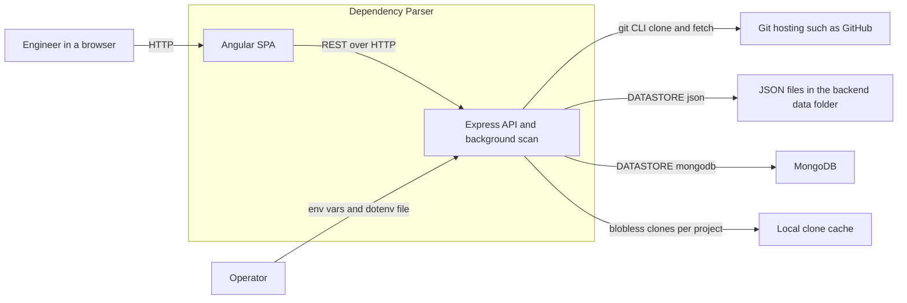
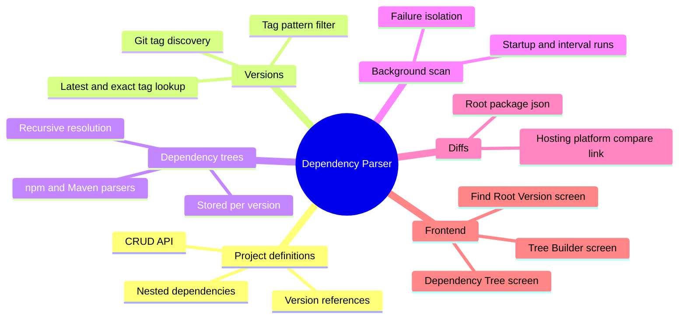
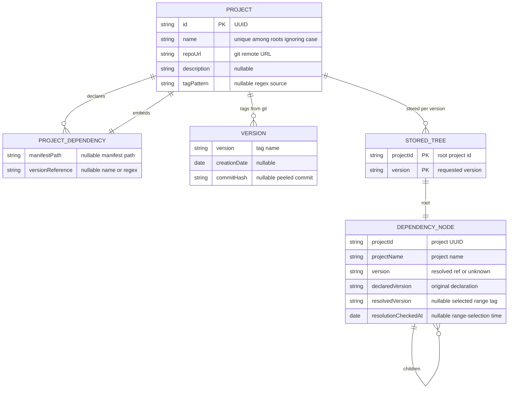
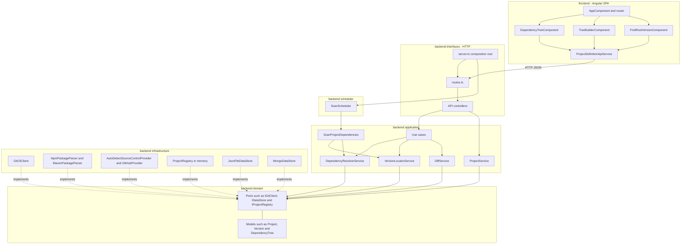
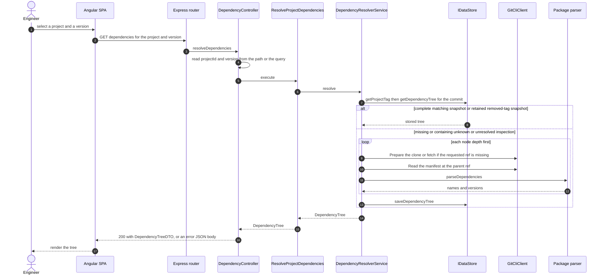
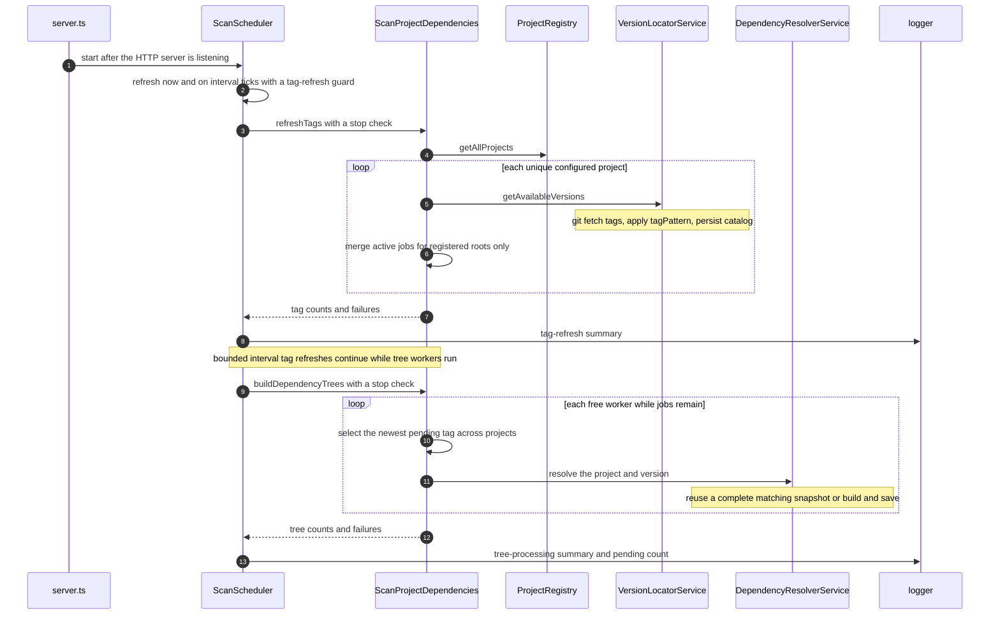
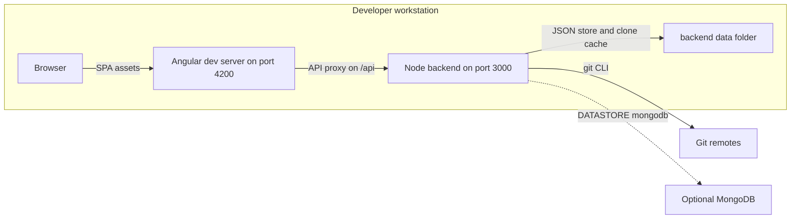

# Dependency Parser: System Reference

This reference describes the implemented system: its architecture, behavior, API contracts, and operating limits. Paths are relative to the repository root. See [Appendix A](#appendix-a-verification-of-existing-documentation) for related documentation.

---

## 1. Overview

### 1.1 What the system does

Dependency Parser tracks how user-defined software projects depend on each other across releases.

- **Project definitions:** a user defines a root project with a Git repository URL, an optional tag pattern, and a nested list of dependency projects. Each dependency identifies the manifest file (`package.json` or `pom.xml`) and the entry that declares its version.
- **Version discovery:** the backend persists observed git tags matching the project's pattern, retaining matching removed entries independently of computed trees.
- **Tree resolution:** for any version, the backend builds the transitive dependency tree. It reads each manifest at the parent's tag through the git CLI, recursing level by level.
- **Persistence:** tag catalogs and commit-aware dependency snapshots are stored in JSON files or MongoDB. Active caches respect project configuration; removed versions can use retained snapshots.
- **Diffs:** two versions of a project's root `package.json` can be compared. A separate commit-history comparison returns commits exclusive to each ref for root or nested projects, with browser links selected for the recognized hosting platform.
- **Background scan**: a job runs at startup and on an interval (default 15 minutes). It refreshes complete matching tag catalogs for roots and configured nested dependencies; only registered roots receive independent dependency-tree jobs.
- **Frontend:** an Angular single-page app with three screens. Dependency Tree browses and compares resolved trees. Tree Builder edits the project definitions. Find Root Version locates the start of the latest parent release run containing a dependency minimum.

### 1.2 Tech at a glance

| Area | Technology |
| --- | --- |
| Backend | Node.js, TypeScript, and Express |
| Frontend | Angular and TypeScript |
| Persistence | JSON files, MongoDB, or no persistence |
| Source and manifests | Git CLI; npm `package.json` and Maven `pom.xml` parsers |
| Tests | Node's test runner for the backend; Vitest and Playwright for the frontend |
| Packaging and CI | Combined Docker test image; GitHub Actions verification and artifacts |

See the [runtime prerequisites](../RUNNING.md#prerequisites) and the [backend](../backend/package.json) and [frontend](../frontend/package.json) package manifests for supported versions.

### 1.3 Context diagram


<!-- Text fallback: the engineer uses the Angular SPA, which calls the Express API. The operator configures the API through environment variables. The API uses the git CLI to clone and fetch from git hosts, keeps blobless clones in a local cache, and persists data to JSON files or MongoDB. -->

The API accesses repositories through the Git CLI, not through hosting-provider APIs. It generates [browser links](../backend/README.md#repository-browser-links) separately from the Git operations. Optional [GitHub credentials](../backend/README.md#github-token-authentication) are used only by the backend Git client.

---

## 2. Functional Requirements

The table summarizes the system's implemented capabilities.



  <!-- Text fallback: the capability areas are project definitions, versions, dependency trees, background scan, diffs and the three frontend screens. -->

| ID | Capability | Behaviour as implemented | Source |
| --- | --- | --- | --- |
| FR-01 | Manage project definitions | **Operations:** list, get, create, update and delete root project definitions.<br>**IDs:** create always assigns a fresh UUID to the root; update keeps the ID in the path. Nested IDs are kept only if they are valid, unused UUIDs.<br>**Validation:** root names must be unique ignoring case (409). Direct sibling dependency names must be unique (400).<br>**Persistence:** writes need a persistent datastore; otherwise they return 503. | `backend/src/application/services/ProjectService.ts`, `backend/src/interfaces/http/controllers/ProjectController.ts` |
| FR-02 | Define nested dependencies | A dependency embeds a full project definition plus:<br>**`manifestPath`:** the manifest file. The parser is chosen by file name: `package.json` or `pom.xml`.<br>**`versionReference`:** an exact package name, a `/pattern/flags` string, or a `{pattern, flags}` object.<br>**`tagPattern`:** must compile as a regular expression. | `backend/src/application/dto/ProjectDefinitionDTO.ts`, `backend/src/domain/models/ProjectDependency.ts` |
| FR-03 | Discover versions | Roots and configured nested dependencies each have a Git tag catalog filtered by `tagPattern`, independent of saved trees. Listings reuse a populated catalog when scans are enabled unless `forceRefresh=true`. Missing matching tags are marked removed only after a successful complete refresh. `latest` is the newest active tag by Git date, with numeric tag-name tie-breaking. | `backend/src/application/use-cases/GetDependencyVersion.ts`, `backend/src/application/services/VersionLocatorService.ts`, `backend/src/interfaces/http/controllers/VersionController.ts` |
| FR-04 | Resolve a requested version | Accepts an exact tag name or `latest`. Prefixed and unprefixed names remain distinct; no `v` prefix is added or removed. Returns 404 when nothing matches. | `VersionLocatorService.resolveVersion`, `VersionController.getVersion` |
| FR-05 | Resolve a dependency tree | Builds the tree for one project and version.<br>**Recursion:** it follows the defined dependencies. Each child's declaration is read at the parent's ref; npm SemVer ranges select the highest compatible configured Git tag before recursion.<br>**Cycles:** guarded by tracking `projectId@version` ancestry.<br>**Unreadable versions:** a child whose version cannot be read becomes `unknown`. | `backend/src/application/services/DependencyResolverService.ts`, `NpmPackageParser.ts` |
| FR-06 | Store and reuse trees | **Storage:** snapshots are keyed by root project, version, and commit hash.<br>**Reuse:** active trees must match the project configuration and resolution-policy fingerprint; npm range selections expire after a configurable TTL, default one day.<br>**Retention:** configuration or policy changes invalidate active reuse without deleting history; removed tags use retained snapshots without TTL expiry. | `DependencyResolverService.ts`, `backend/src/infrastructure/storage/JsonFileDataStore.ts`, `backend/src/infrastructure/storage/MongoDataStore.ts` |
| FR-07 | Background dependency scan | Refreshes root and nested tag catalogs at startup and on a configured interval. Only active registered-root tags enter the tree queue. Tag refresh and tree processing run independently; a failure in one project or tag does not stop other work. | `backend/src/scheduler/ScanScheduler.ts`, `backend/src/application/use-cases/ScanProjectDependencies.ts` |
| FR-08 | Compare package versions | Reports added, removed and updated entries of the root `package.json` `dependencies` between two refs. Also returns a hosting-platform compare URL for recognized repository hosts. | `backend/src/application/services/DiffService.ts`, `backend/src/application/use-cases/ComparePackageVersions.ts`, `backend/src/infrastructure/providers/AutoDetectSourceControlProvider.ts` |
| FR-09 | Health endpoint | `GET /api/health` always returns `{"status":"ok"}`. | `backend/src/interfaces/http/routes/routes.ts` |
| FR-10 | Dependency Tree screen | Browse, filter, and compare resolved trees from selected projects and versions. The comparison marks changed, added, and removed dependencies. The last selection is remembered in the browser. | `frontend/src/app/dependency-tree/dependency-tree.component.ts`, `frontend/src/app/dependency-tree/dependency-tree.models.ts` |
| FR-11 | Tree Builder screen | **Editing:** create and edit nested project definitions, with a draft per project kept in browser storage.<br>**API:** save, update and delete through the API.<br>**Files:** import and export JSON. | `frontend/src/app/tree-builder/tree-builder.component.ts`, `frontend/src/app/tree-builder/tree-builder.models.ts` |
| FR-12 | Theme | Dark and light themes; the preference is saved in the browser. | `frontend/src/app/app.component.ts` |
| FR-13 | Find Root Version | Requires an exact active minimum tag from the selected dependency's refreshed catalog. Inspects root releases newest first and stops at the first confirmed non-match. Returns the start of the latest inspectable matching run, its tree and dependency path, and attempted-release counts. | `backend/src/application/use-cases/FindRootVersion.ts`, `frontend/src/app/find-root-version/find-root-version.component.ts` |
| FR-14 | Commit changelog | **Show changes** opens the Git changelog for a version-changed root or dependency row. It lists commits exclusive to each version with hashes, subjects, timestamps, and browser links. | `backend/src/application/use-cases/CompareVersionCommits.ts`, `frontend/src/app/dependency-tree/commit-diff-dialog.component.ts` |

---

## 3. Non-functional Requirements

The [security policy](../SECURITY.md) defines supported revisions and private vulnerability reporting. There are no published service-level objectives or capacity targets.

### 3.1 Security

**As built:**

- **Git commands:** invoked without a shell. Empty and option-like refs are rejected, and manifest paths are restricted to the clone.
- **Input validation:** project definitions are validated on write, including any regular expressions used for tag patterns and version references.
- **Credentials:** `MONGODB_URI` and `GITHUB_TOKEN` are backend settings. The optional token applies only to HTTPS `github.com` Git operations and is not written to URLs or saved Git configuration. The configured token is redacted from Git error messages. See [GitHub token authentication](../backend/README.md#github-token-authentication).

**Gaps:**

- **No end-user authentication or authorization:** `GITHUB_TOKEN` grants repository access to the backend; it does not protect the API. Operators own end-user access controls; see [deployment responsibilities](../RUNNING.md#deployment-responsibilities).
- **Open CORS:** all origins are allowed. The API has no rate limiting, security-header middleware, or custom request-size policy.
- **Repository URLs and patterns:** URL validation does not restrict repositories to trusted hosts or protocols, accepts local paths, and does not fully guard against Git option injection. Regular expressions are checked for valid syntax, not for costly matching behavior.
- **Raw Git diagnostics:** some API responses and logs include Git diagnostics. Credentials embedded in a `repoUrl` may be exposed even though the configured `GITHUB_TOKEN` is redacted.
- **Host credentials:** Git uses the host's authentication when no configured token applies. An unresolved credential prompt can block requests or scans.

### 3.2 Performance

**As built:**
- **Stored trees:** matching complete snapshots are reused; removed tags can use retained historical snapshots.
- **Version retrieval:** populated scan-enabled catalogs can be listed without Git access. Concurrent source refreshes for the same project share one operation. Selective tag patterns can reduce object transfers on supported Git versions; see [tag discovery](#92-version-discovery-from-git-tags).
- **Newest-run search:** reuses eligible trees and stops at the first confirmed non-match. If every release qualifies or is skipped, the search can visit the full catalog.

**Gaps:**
- **Sequential tree building:** children are resolved one at a time. Manifest reads can fetch missing blobs on demand.
- **Source refreshes:** even selective refreshes enumerate the full remote tag set before applying the pattern.
- **Package diffs:** each package-manifest comparison requires a full temporary clone.
- **JSON store:** each operation reads or rewrites a whole file, so cost grows with the number and size of stored trees.

### 3.3 Reliability

**As built:**
- **Startup:** invalid configuration or a failed MongoDB connection prevents the server from starting.
- **Graceful shutdown:** `SIGINT` and `SIGTERM` stop accepting requests and starting scan jobs. Active scan work finishes before the datastore closes.
- **Scan isolation:** a project or tag failure does not stop unrelated work, and a failed tag refresh does not mark tags as removed.
- **JSON store:** operations are serialized within the process.

**Gaps:**
- **No general Git timeouts/backoff or in-flight cancellation at shutdown.** Confirmed missing dependency refs have bounded retries; authentication/network failures and root refs do not use that retry/fallback policy.
- **JSON writes are not atomic:** a crash during a write can truncate a file. A corrupt project store can prevent startup.
- **Missing source:** a removed root tag can be displayed only if a saved tree exists. Saved snapshots are not a source archive.
- **Registry loaded once:** the project list is read from the datastore only at startup. Edits made directly to the store need a restart.
- **The health check is static:** `/api/health` does not check the datastore or git.

### 3.4 Scalability

Everything runs in a single Node.js process. The project registry, request deduplication, git queues and the scheduler all live in memory. See [Section 5](#5-scalability) for limits and options.

### 3.5 Observability

**As built**:
- **Logger:** timestamped console text with an optional context object. `LOG_LEVEL` controls verbosity; `info` and `debug` go to stdout, and `warn` and `error` go to stderr.
- **Events:** startup, shutdown, scan failures, and separate tag-refresh and tree-processing summaries are logged. Debug logging includes individual tree jobs and root-version search decisions. See the [backend logging reference](../backend/README.md#logging).

**Gaps:**
- **No access logs or request correlation IDs.**
- **No metrics, tracing or alerting.**
- **Not machine-parseable:** log lines are text with a context object, not structured JSON.

### 3.6 Portability

**As built:**
- **Runtime needs:** Node.js and a git CLI on `PATH`.
- **Clone location:** configurable with `CLONE_ROOT`.
- **Test container:** packages the frontend and backend with Git and an SSH client, runs as a non-root user, and supports a mountable data directory.
- **Frontend API origin:** browser requests use `/api`; Angular's development proxy forwards them locally, while the combined image serves both applications on one origin.

**Gaps:**
- **Data paths depend on the working directory:** relative data and clone paths are resolved from the backend process's working directory. Start local runs from `backend/` to use the documented layout.

### 3.7 Compatibility

- **Manifests:**
  - `package.json` with only `dependencies` read (`NpmPackageParser`).
  - `pom.xml` with `<properties>` and `<dependencies>`, resolving `${...}` placeholders, including `project.*` and `pom.*` with a fallback to `<parent>` (`MavenPackageParser`). Profiles, plugins and `dependencyManagement` are not read.
  - Any other manifest name fails with "No parser available" (404).
- **Repository hosts:**
  - Clone and fetch work with any remote the git CLI can reach.
  - Optional `GITHUB_TOKEN` authentication covers HTTPS `github.com` remotes with Git 2.31+; SSH, HTTP, GitHub Enterprise Server, and other hosts retain existing host-provided Git authentication.
  - Browser links support `github.com`, `gitlab.com`, `bitbucket.org`, and Bitbucket Server/Data Center hosts matching `bitbucket.<suffix>`. Other hosts can still be reachable by Git but are not supported for [generated links](../backend/README.md#repository-browser-links).
- **API:**
  - There is no version prefix (`/api` only).
  - The frontend and backend communicate over HTTP; their TypeScript types are not shared.
- **Stored data:**
  - Both stores share one serialization format (`DataStoreSerialization.ts`). Regular expressions are stored as `{pattern, flags}`.
  - There is no migration between JSON and MongoDB.
- **Browsers:** Angular's default browser targets apply.

---

## 4. Estimations

The workload and resource drivers below are qualitative, not benchmark results or capacity targets.

### 4.1 Load pattern

- **HTTP traffic:** opening a tree loads projects and versions and resolves the selected tree. Comparison resolves a second tree; commit history is requested only when the user opens **Show changes**.
- **Background load:** tag catalogs are refreshed at startup and on the configured interval. Tree workers drain the root-version queue independently of that schedule.

### 4.2 Concurrency

- **Shared budget:** `GIT_MAX_CONCURRENCY` bounds each scan phase's worker count and the total active Git commands across scan and API work. It does not count individual network connections opened by Git.
- **Serialization:** repository updates exclude other access to the same clone; revision-pinned reads can otherwise run concurrently. JSON store operations are serialized.
- **Independent resolutions:** an HTTP request and a scan can compute the same tree concurrently; if both save the same snapshot, the last write wins.

### 4.3 Data volume

| Item | What drives growth |
| --- | --- |
| Stored trees | The number of resolved root versions and commits, and the number of configured nodes in each tree. There is no automatic snapshot retention limit. |
| Tag catalogs | Matching tags observed across roots and nested dependencies, including removed tags. |
| Git clone cache | The number and history size of configured repositories and the manifests read from them. |
| Commit comparison caches | Retained comparison results in memory and isolated repository histories on disk. Bounds apply to entry or repository count, not to bytes. |

### 4.4 Dominant costs

- **Git network work:** catalog refreshes, missing refs, on-demand manifest downloads, and uncached comparisons.
- **Tree building:** traversal of each tree is sequential even when multiple root trees are being built.
- **Persistence and disk:** whole-file JSON operations, shared clones, and temporary comparison repositories.

### 4.5 Latency

No latency targets exist. The table below gives qualitative expectations based on what each path does.

| Path | Expected latency driver |
| --- | --- |
| Tree with a matching complete snapshot | Catalog and snapshot reads |
| Missing or incomplete tree | Sequential manifest inspection and any required Git fetches |
| Version list | Stored catalog and snapshot availability; cold, disabled-scan, or forced refreshes also access Git |
| Package-manifest diff | A full temporary clone |
| Commit changelog | A memory lookup on a cache hit; otherwise Git retrieval and history traversal |
| Scan pass | One tag refresh per configured project, plus any tree work for eligible root releases |

---

## 5. Scalability

**Current model:** each backend runs in one process. Multiple instances do not coordinate their registries, scanners, or caches.

| Bottleneck | Why | Source |
| --- | --- | --- |
| In-memory project registry | Loaded once at startup. Create, update and delete calls change only the local instance's copy. | `server.ts`, `backend/src/infrastructure/registry/ProjectRegistry.ts`, `ProjectService.ts` |
| JSON datastore | Whole-file rewrites, and only one process can use it safely, since the queue is in-process. | `JsonFileDataStore.ts` |
| Scheduler per process | Every instance with scanning enabled runs its own full pass. | `ScanScheduler.ts`, `server.ts` |
| Bounded tree resolution | Up to `GIT_MAX_CONCURRENCY` background trees, with newest-first selection for free workers and a shared Git-command budget. Node recursion within each tree remains sequential. | `ScanProjectDependencies.ts`, `DependencyResolverService.ts`, `GitCliClient.ts` |
| Local clone cache | Kept per host, and grows with the number of defined projects. | `DependencyResolverService.ensureClone`, `VersionLocatorService.getClonePath` |

**Running more than one instance:**
- **Persistence:** use MongoDB. Per-document upserts and unique indexes on `{projectId, name}` for tags and `{projectId, version, commitHash}` for snapshots prevent duplicate identities. Concurrent scans across processes are still not coordinated.
- **Scanning:** enable it on one instance only, by setting `DEPENDENCY_SCAN_ENABLED=false` on the others.
- **Project list:** instances still don't see each other's project changes until they restart, because the registry is in memory.

---

## 6. Out of Scope

End-user authentication and authorization are operator responsibilities. The table lists the limits of the base application.

| Area | Status | Evidence |
| --- | --- | --- |
| End-user authentication and authorization | Operator-owned extension or fork | No user-authentication or role middleware in `server.ts` or `routes.ts`; see [deployment responsibilities](../RUNNING.md#deployment-responsibilities) |
| Multi-tenancy | Not implemented | No tenant middleware in `server.ts` or `routes.ts` |
| Resolving third-party package graphs from the npm registry or Maven repositories | Not implemented | The resolver follows only dependencies declared in project definitions. Parsed manifest entries are used only to look up a declared dependency's version (`DependencyResolverService.readDependencyVersion`). |
| npm `devDependencies`, `peerDependencies`, lockfiles, registry tags/aliases and local/workspace/Git specifications | No ecosystem-specific resolution | `NpmPackageParser` reads `dependencies` only. SemVer ranges are resolved against configured Git tags; non-SemVer specifications retain literal-ref behavior. |
| Maven profiles, plugins, `dependencyManagement`, remote parent POMs | Not read | `MavenPackageParser.ts` |
| Manifests other than `package.json` and `pom.xml` | Not supported | Each parser's `supports()` method |
| Diffs for Maven or for manifests other than the root `package.json` | Not implemented | `server.ts` builds `DiffService` with `NpmPackageParser` and `"package.json"` |
| Showing root package-manifest diff results in the frontend | Not implemented | The frontend never calls `/diffs`; commit changelogs use the separate `/commit-diffs` endpoint (`project-definition-api.service.ts`) |
| Arbitrary self-hosted domains and custom browser-link templates | Not implemented | Browser links use the [documented host rules](../backend/README.md#repository-browser-links). |
| CLI interface | Not implemented | There is no `backend/src/interfaces/cli/` |
| Durable or distributed jobs, scan history and status, an API to trigger a scan | Not implemented | `ScanScheduler` is an in-process timer, and scan results are only logged |
| Metrics, tracing, alerting | Not implemented | Only `backend/src/utils/logger.ts` exists |
| Registry publishing, Helm charts, and production deployment | Not implemented | See [Section 10](#10-deployment) |

### Remaining Work

- Package-manifest diffs are available through the API only; the browser compares trees and Git history.
- The combined image is intended for testing. See [deployment gaps](#104-gaps-to-close-before-a-shared-or-production-deployment) for what operators must provide for shared or production use.

---

## 7. Entities and Core APIs

### 7.1 Entity relationships


<!-- Text fallback: a project declares project dependencies, and each dependency embeds a full nested project. A project has versions discovered from git tags and stored trees keyed by root project id and version. A stored tree has one root dependency node, and each node has child nodes. -->

**Notes:**
- **Nested projects are embedded:** they live inside their root's definition (`ProjectDependency.project`), not in separate registry entries. The project CRUD API manages roots only. Nested projects have tag catalogs, but do not get independent tree scan jobs.
- **Persistent tags:** `ProjectTag` is stored independently of trees, keyed by project ID and tag name. `Version` is the catalog-backed listing view. The diagram abstracts snapshot commit identity; the full key is project ID, version, and commit hash.
- **Node identity:** a node's derived ID is `projectId@version` (`DependencyNode.id`), and `DependencyTree.flatten` uses it to remove duplicates.

### 7.2 Entity fields and transient types

| Type | Fields | Source |
| --- | --- | --- |
| `Project` | `id`, `name`, `repoUrl`, `description`, `dependencies` (array or null), `tagPattern` | `backend/src/domain/models/Project.ts` |
| `ProjectDependency` | `project` (nested `Project`), `manifestPath`, `versionReference` (string, RegExp or null) | `backend/src/domain/models/ProjectDependency.ts` |
| `Version` | `version`, `creationDate`, `commitHash`, `removed`, `hasDependencyTree` | `backend/src/domain/models/Version.ts` |
| `ProjectTag` | `projectId`, `name`, `commitHash`, `creationDate`, `removed` | `backend/src/domain/models/ProjectTag.ts` |
| `DependencyTree` | `root`, the top-level dependency node | `backend/src/domain/models/DependencyTree.ts` |
| `DependencyNode` | `projectId`, `projectName`, `version`, `dependencies`, `dependenciesResolved` (defaults true), `declaredVersion`, nullable `resolvedVersion` and `resolutionCheckedAt` | `backend/src/domain/models/DependencyNode.ts` |
| `Dependency` (a parsed manifest entry) | `name`, `version` | `backend/src/domain/models/Dependency.ts` |
| `ParseResult` | `dependencies`, `metadata.packageManager`, `metadata.raw` | `backend/src/domain/types/ParseResult.ts` |
| `DiffResult` / `DependencyChange` | `added`, `removed`, `updated`, each a list of `{name, fromVersion, toVersion}` | `backend/src/domain/types/DiffResult.ts` |
| `DependencyScanResult` *(logged only)* | `projectCount`, `tagCount`, `resolvedTreeCount`, `failures` (`projectId`, optional `version`, `error`) | `backend/src/application/use-cases/ScanProjectDependencies.ts` |

### 7.3 Persistence mapping

| Store | Projects | Trees | Source |
| --- | --- | --- | --- |
| `DATASTORE=json` | `<cwd>/data/projects.json`: `{ "projects": { "<rootId>": SerializedProject } }` | `<cwd>/data/dependency-trees.json`: version-keyed snapshot arrays containing `root`, `commitHash`, and `projectConfiguration` | `server.ts` (`buildDataStore`), `JsonFileDataStore.ts` |
| `DATASTORE=mongodb` | Collection `projects`: a `SerializedProject` with `_id` set to the project ID | Collection `dependencyTrees`: `projectId`, `version`, `root`, `commitHash`, `projectConfiguration`, `savedAt`; unique project/version/commit index | `MongoDataStore.ts` |
| Unset, empty or `memory` | Nothing is stored and the registry starts empty | Nothing is stored or reused | `server.ts` |

Both stores share one serialization format, defined in `backend/src/infrastructure/storage/DataStoreSerialization.ts`. Regular-expression version references are stored as `{pattern, flags}`.

Nodes persist original declarations, selected range tags, and ISO UTC resolution timestamps. The earliest range timestamp determines the tree's TTL expiry; exact-only trees have no expiry. Both adapters exclude expired active trees from cache reads and snapshot-availability flags without deleting their data. Removed-root historical snapshots bypass expiry.

Tags are stored separately in `<cwd>/data/tags.json` as project-keyed arrays, or in MongoDB `tags` with a unique `{projectId: 1, name: 1}` index. There are no automatic datastore migrations.

### 7.4 Backend REST API

- **Mounting:** all routes sit under `/api` (`server.ts`) and are registered in `backend/src/interfaces/http/routes/routes.ts`. The one exception is `/api/hello`, registered in `server.ts`.
- **End-user access:** no API route authenticates application users or enforces roles. Operators supply these controls through their own extension or fork.
- **Errors:** application errors use `{ "error": "<message>" }`. Express handles malformed JSON before it reaches the routes.

| Method | Path | Auth / role | Handler | Purpose and responses |
| --- | --- | --- | --- | --- |
| GET | `/api/health` | None | inline, `routes.ts` | Liveness check. `200 {"status":"ok"}` |
| GET | `/api/hello` | None | inline, `server.ts` | Greeting endpoint. `200 {"message":...}` |
| GET | `/api/projects` | None | `ProjectController.getAllProjects` | Root definitions from the in-memory registry. `200 {"projects": ProjectDefinitionDTO[]}` |
| POST | `/api/projects` | None | `ProjectController.createProject` | Create a definition. 201, 400 invalid input, 409 duplicate name, 503 no datastore |
| GET | `/api/projects/:projectId` | None | `ProjectController.getProject` | One definition. 200 or 404 |
| PUT | `/api/projects/:projectId` | None | `ProjectController.updateProject` | Replace a definition, invalidating active cache reuse while retaining history. Repository URL changes clear old tags and snapshots. 200, 400, 404, 409, 503 |
| DELETE | `/api/projects/:projectId` | None | `ProjectController.deleteProject` | Delete a definition and its stored trees. 204, 404, 503 |
| GET | `/api/projects/:projectId/versions` | None | `VersionController.getAvailableVersions` | List stored active/removed tags when scans are enabled; refresh source if the cached list is empty, scans are disabled, or `?forceRefresh=true`. `200 {projectId, versions: VersionDTO[], latest}` |
| GET | `/api/versions?projectId=` | None | `VersionController.getAvailableVersions` | Query alias of the row above |
| GET | `/api/projects/:projectId/versions/:requestedVersion` | None | `VersionController.getVersion` | Exact tag name or `latest`, without adding or removing `v`. `200 {projectId, requestedVersion, resolvedVersion}` or 404 |
| GET | `/api/versions/resolve?projectId=&requestedVersion=` | None | `VersionController.getVersion` | Query alias; `version=` also works |
| GET | `/api/projects/:projectId/versions/:version/dependencies` | None | `DependencyController.resolveDependencies` | Resolve or reuse the tree. `200 DependencyTreeDTO` |
| GET | `/api/dependencies?projectId=&version=` | None | `DependencyController.resolveDependencies` | Query alias |
| GET | `/api/projects/:projectId/find-root-version?dependencyProjectId=&minimumVersion=` | None | `VersionSearchController.findVersion` | Start of the latest inspectable containing release run, found newest-first through the first non-match; confirmed missing refs are skipped. `200 FindRootVersionDTO`, with `match: null` for no current run; 400 invalid input; 500 other incomplete or unorderable search |
| GET | `/api/projects/:projectId/commit-diffs?fromVersion=&toVersion=` | None | `CommitDiffController.compareCommits` | Root or configured nested project's exclusive commit histories. `200 CommitDiffDTO`; 400 invalid/repeated input; 404 unknown project/ref; 500 Git or link-provider failure |
| GET | `/api/projects/:projectId/diffs/:fromVersion/:toVersion` | None | `DiffController.compareVersions` | Root `package.json` diff. `200 DiffResultDTO` |
| GET | `/api/projects/:projectId/diffs?fromVersion=&toVersion=` | None | `DiffController.compareVersions` | Refs as query parameters; `fromRef` and `toRef` also work |
| GET | `/api/diffs?projectId=&fromVersion=&toVersion=` | None | `DiffController.compareVersions` | Query alias |

**Response DTOs:**
- `ProjectDefinitionDTO` and `DependencyDefinitionDTO`: `backend/src/application/dto/ProjectDefinitionDTO.ts`
- `DependencyTreeDTO`, which is `{projectId, projectName, version, tree}` where `tree` is a `DependencyNodeDTO`. Each node includes `creationDate` as an ISO UTC string or null. Range nodes also expose `declaredVersion`, nullable `resolvedVersion`, and ISO UTC `resolutionCheckedAt`; `version` remains the single UI/display value. Nodes emit optional `dependenciesResolved: false` for unresolved inspection; absence means true: `backend/src/application/dto/DependencyTreeDTO.ts`
- `DiffResultDTO`, which is `{projectId, projectName, fromVersion, toVersion, compareUrl, added, removed, updated}`: `backend/src/application/dto/DiffResultDTO.ts`
- `CommitDiffDTO`: `projectId`, `projectName`, `fromVersion`, `toVersion`, full `fromCommitHash` and `toCommitHash`, and `fromOnly`/`toOnly` arrays of `{hash, subject, committedAt, url}`. `committedAt` is the Git committer's ISO timestamp with its original offset, not the author or tag date. The arrays contain commits reachable only from their respective refs: `backend/src/application/dto/CommitDiffDTO.ts`.
- `VersionDTO`: `version`, `creationDate`, `commitHash`, `removed`, `hasDependencyTree`; the Git date is an ISO string or null (`backend/src/application/dto/VersionDTO.ts`).
- `FindRootVersionDTO`: `projectId`, `dependencyProjectId`, `minimumVersion`, `checkedVersions`, `totalVersions`, `warnings`, and nullable `match`; a match contains `version`, `dependencyVersion`, `path`, and `dependencyTree`. Warnings are grouped by inspected root tag and identify unavailable trees or distinct unresolved dependency versions (`backend/src/application/dto/FindRootVersionDTO.ts`).

**Status codes:**

Project CRUD lookups return `404` for unknown roots. Tree requests return `404` for removed tags without saved snapshots. Find Root Version returns `400` for invalid input, including an unknown root or invalid minimum tag, and `500` when a retrieval failure prevents the search from completing. Commit changelogs distinguish an unavailable ref (`404`) from a failed comparison (`500`); failures are not returned as empty commit lists. See the [backend API reference](../backend/README.md#api-overview).

### 7.5 Frontend routes and backend calls

| Route | Component | Auth / role | Purpose | Source |
| --- | --- | --- | --- | --- |
| `/` | n/a | None | Redirects to `/tree` | `frontend/src/app/app.routes.ts` |
| `/tree`, `/tree/:projectId` | `DependencyTreeComponent` | None | Browse and compare resolved trees | `app.routes.ts` |
| `/builder` | `TreeBuilderComponent` | None | Edit project definitions | `app.routes.ts` |
| `/find-root-version` | `FindRootVersionComponent` | None | Find Root Version: start of the latest inspectable parent release run meeting a dependency minimum | `app.routes.ts` |

All three screens use the shared `ProjectDefinitionApiService` for same-origin calls to `/api/projects` and its subroutes. The Angular development server proxies `/api/**` to the backend. The browser uses commit changelogs, not the package-manifest diff endpoint.

### 7.6 Configuration

| Variable | Default | Allowed values and effect | Source |
| --- | --- | --- | --- |
| `PORT` | `3000` | HTTP port | `server.ts` |
| `FRONTEND_DIST` | unset, meaning API-only | Optional Angular browser build directory, absolute or relative to the working directory; must contain an `index.html` file. The Docker image sets `/app/frontend`. | `server.ts`, root `Dockerfile` |
| `DATASTORE` | unset, meaning no persistence | `json`, `mongodb` or `memory`; any other value fails startup | `server.ts` (`buildDataStore`) |
| `MONGODB_URI` | none | Required when `DATASTORE=mongodb` | `server.ts` |
| `MONGODB_DATABASE` | `dependency_parser` | MongoDB database name | `server.ts` |
| `CLONE_ROOT` | `<cwd>/data/repositories/git` | Clone cache folder | `server.ts` |
| `LOG_LEVEL` | `info` | `error`, `warn`, `info` or `debug`; invalid values prevent startup | `backend/src/config/app.config.ts` |
| `DEPENDENCY_SCAN_ENABLED` | `true` | `true` or `false`; any other value fails startup | `app.config.ts` |
| `GIT_MAX_CONCURRENCY` | `4` | Positive safe integer; shared active Git-command limit and per-phase background worker count; `1` serializes each phase | `app.config.ts`, `server.ts` |
| `GITHUB_TOKEN` | none | Optional shared backend PAT for HTTPS `github.com` remotes with Git 2.31+; trims surrounding whitespace, ignores blank values, rejects embedded whitespace/control characters | `app.config.ts`, `server.ts`, `GitCliClient.ts` |
| `DEPENDENCY_RESOLUTION_RETRIES` | `2` | Nonnegative safe integer; additional attempts for confirmed missing dependency refs, shared across concurrent requests for the same dependency/ref | `app.config.ts`, `DependencyResolverService.ts` |
| `NPM_RANGE_RESOLUTION_TTL_MINUTES` | `1440` | Positive safe integer minutes; persisted npm range selections expire for API requests and background scans, without affecting exact-only trees | `app.config.ts`, storage adapters, `ScanProjectDependencies.ts` |
| `DEPENDENCY_SCAN_INTERVAL_MINUTES` | `15` | Must convert to a whole number of milliseconds from 1 to 2147483647 | `app.config.ts` |

See [backend environment setup](../backend/README.md#environment-setup) for the example file, credential handling, and shell overrides.

---

## 8. Architecture

### 8.1 System architecture


<!-- Text fallback: Angular components call ProjectDefinitionApiService, which calls the Express routes. server.ts builds every object and starts the scheduler. Controllers call use cases or ProjectService; the scan use case calls the version locator and the resolver. Application services depend only on domain ports, which the infrastructure adapters implement. -->

- **Composition:** `server.ts` wires the adapters, services, use cases, and controllers. HTTP requests and background scans share the Git client, project registry, datastore, version locator, and tree resolver, so their queues and request deduplication work across both paths.
- **Comparisons:** package diffs and commit changelogs use the same hostname-based browser-link provider. Commit comparisons keep their Git history and result caches separate from the scan catalogs.
- **Tree timestamp metadata:** a shared service reads dates from stored catalogs or existing local clones and adds them to tree responses. It does not fetch remote tags or modify stored snapshots. See the [timestamp contract](../backend/README.md#dependency-tree-timestamps).

### 8.2 Request lifecycle: resolving a dependency tree


<!-- Text fallback: the SPA requests the tree; the controller validates parameters and calls the use case and resolver. The resolver reads the tag and matching snapshot. Active tags reuse a complete current-configuration snapshot or build at the recorded commit. Removed tags return retained snapshots, or 404 when no snapshot exists. -->

After resolution, the controller adds creation dates through the shared metadata service before serializing the DTO. Find Root Version applies the same enrichment only to its matched tree, not to every tree inspected during the search.

### 8.3 Layering

The backend follows ports and adapters (hexagonal architecture). HTTP controllers and the scheduler call the application layer, which uses domain models and ports. Infrastructure provides the adapters. The domain has no dependency on frameworks or Node.js built-ins.

| Layer | Folder | Responsibility | Depends on |
| --- | --- | --- | --- |
| Domain | `backend/src/domain/` | Models, types, and ports such as `IGitClient`, `IDataStore`, and `IProjectRegistry` | Nothing |
| Application | `backend/src/application/` | Services, use cases and DTO mappers | Domain and Node.js built-ins |
| Infrastructure | `backend/src/infrastructure/` | Git CLI, parsers, hosting-platform browser URLs, in-memory registry, JSON and MongoDB stores | Domain, Node.js built-ins, and adapter libraries |
| Interfaces | `backend/src/interfaces/http/` | Express server, routes and controllers; `server.ts` is also the composition root | Application, infrastructure, and (as composition root) scheduler, config and utils |
| Scheduler | `backend/src/scheduler/` | Interval timer and scan lifecycle | Application, utils |
| Config and utils | `backend/src/config/`, `backend/src/utils/` | Environment parsing and the logger | Each other only: the logger reads its level through `config/app.config.ts` |

The Angular app is a separate npm package with no shared code. It reaches the backend only over HTTP.

### 8.4 Process lifecycle

1. **Composition:** validate configuration, initialize adapters and services, and load saved root projects into the registry before mounting routes.
2. **Startup:** listen on `PORT`, then begin automatic scans if enabled and persistence is configured.
3. **Shutdown:** stop accepting requests and scheduling scan jobs. Wait for active scan work before closing the datastore; normal shutdown also waits for comparisons and removes their temporary histories.

---

## 9. Explanation of Key Features

### 9.1 Project definitions and the registry

A project requires a name and repository URL. Dependencies embed their own project definitions recursively, with a manifest path and a version reference. A version reference can be an exact package name, a `/pattern/flags` string, or a `{pattern, flags}` object. The tag pattern must be a valid regular expression.

Root names are unique ignoring case; direct sibling dependency names must also be unique. A new root receives a UUID. Nested IDs are retained only if valid and unused. Writes update the datastore before the in-memory registry; project reads use the registry and return root definitions with their nested dependencies.

### 9.2 Version discovery from git tags

Roots and configured nested dependencies each have a catalog based on their own repository and tag pattern. The version-list endpoint reuses a populated catalog when scans are enabled. An empty catalog, disabled scans, or `forceRefresh=true` triggers a Git refresh. Scheduled scans always refresh the source.

With a selective pattern and Git 2.45+, the backend can filter remote tag refs before transferring objects. The compatibility path uses a full, blobless clone and tag-only refreshes. Tag discovery and tree resolution share a per-project clone cache; a missing source ref can cause a shallow catalog to expand to full history. See [tag history and snapshots](../backend/README.md#tag-history-and-snapshots).

Only a successful complete refresh updates the stored catalog. Missing matching tags are retained with `removed=true`, and reappearing tags become active again. Tags outside the current pattern are dropped from the catalog without deleting their saved trees. An unset pattern accepts all tags.

Tags are sorted by creation date, newest first, with numeric tag-name tie-breaking and undated tags last. Annotated tags use the tagger date; lightweight tags use the referenced commit's committer date. `latest` refreshes tags and selects the newest active entry. Removed entries indicate whether a saved tree is available.

Exact lookups and tag patterns use original names: `v5.3.0` and `5.3.0` are distinct. A pattern can include both forms without making them aliases.

### 9.3 Dependency tree resolution

**Starting point:** the resolver checks tag metadata and saved trees. A complete active snapshot can be reused when it matches the recorded commit and current project configuration and resolution policy, with unexpired npm range selections. Explicit requests can retry incomplete inspection while reusing still-fresh range selections, including no-match results. A removed tag returns its retained snapshot, even if incomplete; without one, the tree is unavailable. Active tracked tags are built at their recorded commit and keep the original tag name in the root node.

**Building a node:**
1. Read the configured manifest at the parent's ref, preparing the Git cache if needed.
2. Select the parser by filename and find the entry matching `versionReference`.
3. Use literal refs for exact declarations. For npm ranges, select the highest compatible active Git tag allowed by the dependency's pattern, using npm SemVer rules.
4. Recurse at the original selected ref. Range nodes retain `declaredVersion`, nullable `resolvedVersion`, and `resolutionCheckedAt` alongside the display `version`.

Range selection is inferred from Git tags, not a reconstruction of a historical installation. The resolver does not use lockfiles or the npm registry. See the [npm range contract](../backend/README.md#npm-version-ranges).

**Edge cases:**
- **Missing version data:** a missing manifest/reference or no matching version produces `unknown` for that dependency and its configured descendants.
- **No compatible npm tag:** preserve the declaration, set `resolvedVersion=null` and `dependenciesResolved=false`, populate configured descendants as unknown, and log a warning. The attempted resolution has a timestamp and can be retried after TTL expiry.
- **Unavailable dependency ref:** after bounded retries for confirmed missing refs, the node retains its declared version with `dependenciesResolved=false`. Its configured descendants are `unknown`; an unavailable leaf still has no children.
- **Cycles:** stopped by tracking `projectId@version` ancestry.
- **Saving:** the finished tree is saved under the root project, requested version, and known commit hash, with its project configuration.
- **Retry boundaries:** root-ref, authentication, network, configuration, manifest, and datastore failures remain errors rather than falling back to partial data.

### 9.4 Persistence and cache invalidation

`IDataStore` (`backend/src/domain/interfaces/IDataStore.ts`) has two implementations. The choice is made at startup with `DATASTORE`, and there is no fallback between them.

- **JSON files:** project definitions, tag catalogs, and tree snapshots are separate files. Operations are serialized in-process. Reads parse the whole file; writes replace it. An absent file is treated as empty.
- **MongoDB:** projects, tags, and snapshots use separate collections and per-document upserts. Unique indexes enforce tag and snapshot identities.

Snapshots are keyed by root project, version, and commit. Their configuration fingerprint covers the project definition and the version-resolution policy. A moved tag or changed configuration invalidates active reuse without deleting prior snapshots. Removed tags can use historical snapshots. Changing a repository URL or deleting its project clears that project's catalog and snapshots.

For trees with npm ranges, expiry is measured from the earliest saved range-resolution timestamp, including no-match selections. `NPM_RANGE_RESOLUTION_TTL_MINUTES` defaults to one day. The next request or scan rebuilds an expired active tree; a failed refresh does not serve expired data as though it were current. Exact-only trees and retained removed-tag snapshots do not expire.

### 9.5 Background dependency scan


<!-- Text fallback: startup and interval ticks refresh complete matching catalogs for every unique root and configured nested dependency. Only active root tags update the deduplicated in-memory tree queue. A bounded tree-worker pool selects newest pending root tags when slots become free, including same-project versions. Both phases and API work share one Git-command limit. Phase-specific failures and summaries are logged. -->

- **Schedule:** with persistence and scanning enabled, refreshes start when the API is listening and repeat at the configured interval. An overlapping tag refresh skips the tick; active tree work does not.
- **Discovery:** each pass refreshes the catalog for every unique root and configured descendant, whether or not its tags appear in a tree.
- **Queue:** only active registered-root tags become tree jobs. Jobs are deduplicated by project, tag, commit, and project configuration; refreshes discard obsolete pending jobs. Current saved trees are skipped, including partial ones, but expired npm range trees are eligible again.
- **Priority:** free workers take the newest tags by creation date across projects. Numeric tag-name order breaks date ties and orders undated tags, which come last. New jobs can move ahead of pending work without interrupting running trees.
- **Failures:** failures are isolated by project or tag. A failed tree job can be retried by later refreshes, up to three total attempts per unchanged job per process run.
- **Stopping:** shutdown stops scheduling and starting work, then waits for active refreshes and trees. Git commands are not forcibly cancelled.

The queue and retry history are in memory and are not coordinated between processes. There is no scan-history API; logs report progress and failures. Continuous arrival of new tags can delay older jobs. See [backend scan operations](../backend/README.md#background-dependency-scans).

### 9.6 Package diff

The package diff compares the root `package.json` `dependencies` between two refs and reports added, removed, and updated entries. It uses a full temporary clone for each comparison and deletes it afterward. This endpoint is API-only.

The same hostname-based provider builds package comparison links and commit links. Browser links omit credentials and use the platform's URL format, while Git uses the configured clone address unchanged. Unsupported or malformed browser-link addresses fail explicitly. See the [backend browser-link contract](../backend/README.md#repository-browser-links) for supported hosts and formats.

#### Commit changelog

Commit changelogs compare the Git history of two refs for a registered root or a configured nested project. They return the commits exclusive to each side, descendants first, rather than comparing manifests or version numbers. Shared commits are excluded, and identical commits produce two empty lists.

On a cache miss, exact tag comparisons fetch the selected histories into isolated repositories and deepen them until the complete difference is known. Stored tag identities can guide retrieval but do not replace resolving the current refs. General Git refs can require a separate temporary clone. Neither path updates the scan catalogs. Failed or incomplete retrieval returns an error, not a partial or empty changelog.

The backend retains a bounded set of temporary history repositories and caches successful results in memory for up to 24 hours. Reversed requests reuse the result with the two sides swapped. A catalog refresh does not invalidate that cache, so moved or deleted tags may show stale results until expiry, eviction, or restart. Without a cached result, a deleted ref returns `404` even if a saved tree is still available. See the [backend changelog contract](../backend/README.md#commit-changelogs) for cache limits and error responses.

### 9.7 Configuration, logging and lifecycle

The backend reads [configuration](#76-configuration) at startup from the environment or `backend/.env`. [Console logging](#35-observability) is controlled by `LOG_LEVEL`. See [process lifecycle](#84-process-lifecycle) for initialization and shutdown behavior.

### 9.8 Dependency Tree screen

- **Browse:** select a project and version, filter and expand or collapse the resolved tree, copy versions, and open repository links. The last selection and comparison are remembered in browser storage.
- **Compare:** the browser merges two trees by `projectId` and marks rows `unchanged`, `changed`, `added`, or `removed`. Changed rows expose **Show changes** to load exclusive commits for that row on demand, with separate baseline and comparison lists.
- **Version picker:** both pickers share a searchable catalog and a **Refresh versions** action. A failed refresh keeps the previous list and selections. Removed tags are selectable only when their saved trees are available.
- **Tag dates:** hover or keyboard focus on a version shows its tag date in GMT, if known. Baseline and comparison dates are independent and come from the tree response, without extra requests.

See the [frontend screen reference](../frontend/README.md#current-screens) for picker, tree, and dialog behavior.

### 9.9 Tree Builder screen

Tree Builder creates and edits nested project definitions. It checks for duplicate sibling names, supports saving and deleting through the API, and imports or exports JSON. Validation errors keep the draft available for correction.

Drafts and the last selected project are kept in browser storage. A saved-project draft is restored only after the project list confirms that the project is still available. New, unsaved drafts can be edited offline.

### 9.10 Find Root Version screen and search

The user selects a root, a configured descendant, and a minimum dependency version. Before inspecting root releases, the backend refreshes that dependency's catalog and requires an exact active tag that matches its pattern. An invalid minimum is a validation error, not a no-match result. The root catalog uses the ordinary scan-aware listing policy.

The search visits root tags by creation date, newest first, using numeric fields to break ties and ordering undated tags last. Dependency versions are compared numerically, reading digit sequences from left to right, not by SemVer prerelease precedence. The search retains the last qualifying tree and stops at the first confirmed non-match. That finds the start of the latest inspectable qualifying run, not the oldest historical match.

A known qualifying occurrence is enough to match. If no known occurrence qualifies, unknown versions on paths that could contain the selected dependency make that release undecidable. Such releases and confirmed missing refs are skipped, not treated as non-match boundaries. Other retrieval or resolution failures end the search with an error. `checkedVersions` includes skips and the stopping boundary; `totalVersions` is the catalog size. Warnings are grouped by inspected root tag and can accompany either a match or no match. See the [backend search contract](../backend/README.md#find-root-version).

The screen displays the matching version, dependency path, counts, and returned tree without another tree request. It also distinguishes no match from a failed search and shows warning details. The browser restores the last completed result, including no match, after validating the project and dependency, without rerunning the search. Changing inputs or starting a new search clears the saved result and cancels obsolete requests.

---

## 10. Deployment

### 10.1 Status

The repository provides a combined test Docker image and downloadable CI image artifacts with matching Git tags. Production deployment, registry publishing, compose/orchestration manifests, and infrastructure-as-code are not defined. Local development still uses separate Angular and Node processes.

The root [Dockerfile](../Dockerfile) packages both builds. A single non-root Node process serves Angular assets and `/api` on port 3000. The image defaults to JSON persistence; mount `/app/backend/data` to retain the datastore and clone cache. Local data and credentials are excluded from the build context.

The image health check verifies `/api/health`, not external Git or MongoDB. Runtime secrets must be injected rather than baked into the image. See the [Docker and Podman commands](../RUNNING.md#build-and-run-in-a-container) and [CI image download instructions](../RUNNING.md#loading-a-ci-image).

### 10.2 Current topology (local development)


<!-- Text fallback: on a workstation, the browser loads the SPA and makes same-origin API requests to the Angular dev server on port 4200. Angular proxies /api requests to the Node backend on port 3000. The backend stores JSON data and clones under the backend data folder, reaches git remotes through the git CLI, and can optionally use MongoDB. -->

Local development runs the backend and frontend separately; the Angular server proxies `/api` to the backend. See the [startup commands](../RUNNING.md#start-both-applications). For same-origin hosting without the development server, set `FRONTEND_DIST` to serve the Angular build and its HTML routes alongside the API. See [frontend hosting](../backend/README.md#frontend-hosting-and-docker).

### 10.3 Runtime prerequisites

- **Tools:** Node.js in the range declared by the root `engines` field and npm 10+; see the [development prerequisites](../RUNNING.md#prerequisites).
- **Git:** a git CLI on `PATH`, with the credentials needed for every configured repository. Optional HTTPS GitHub token authentication requires Git 2.31+; see the [backend setup](../backend/README.md#github-token-authentication).
- **Storage:** a writable clone cache (`CLONE_ROOT`), and a writable `backend/data/` for the JSON store in the standard local layout.
- **Configuration:** environment variables from [Section 7.6](#76-configuration), from the environment or `backend/.env`.
- **MongoDB:** a reachable server when `DATASTORE=mongodb`.

The packaged image requires a Linux container engine instead of host Node, npm, and Git installations. Any bind-mounted data directory must be writable by the container user; see the [container configuration](../backend/README.md#frontend-hosting-and-docker).

### 10.4 Gaps to close before a shared or production deployment

Environment provisioning, deployment pipelines, and database operation are [operator responsibilities](../RUNNING.md#deployment-responsibilities), not services supplied by this project. Before shared or production use, address these application limitations and environment-specific needs:
- **Release hardening:** immutable base-image selection, image registry publishing, and deployment/orchestration policy beyond the downloadable test images.
- **Access:** implement end-user authentication and authorization in an operator-maintained extension or fork, provision TLS, and secure the external serving boundary. Same-origin hosting does not secure the API.
- **Secrets:** production delivery and rotation for `MONGODB_URI` and Git credentials. Optional `GITHUB_TOKEN` is environment-backed, not a secret-manager integration.
- **Storage:** production volume provisioning, optional MongoDB setup, and backup/recovery for the configured datastore and clone caches.
- **Single scanner:** make sure only one instance scans.
- **Health:** a health check that covers the datastore and git.

### 10.5 Continuous integration

The [GitHub Actions workflow](../.github/workflows/ci.yml) verifies branch pushes, pull requests, and manual runs. It installs from lockfiles, lints, builds both applications, and runs application and workflow tests. Each application has its own [coverage gate](../CONTRIBUTING.md#coverage-policy); failing verification blocks image packaging. Coverage reports are uploaded as downloadable artifacts.

Run `npm run verify` for local verification. See the [contributor guide](../CONTRIBUTING.md#verification-and-ci) for prerequisites and available checks.

#### Versioned Git tags and image artifacts

Successful `main` and pull-request verification runs build and smoke-test a combined container. The image is uploaded as a downloadable archive with a build-version tag and a commit tag; it is not published to a registry or deployed. See [Loading a CI image](../RUNNING.md#loading-a-ci-image).

Mainline CI tags use `main.<N>` and reuse an existing tag for the same commit. Pull-request versions use `main.<N>-pr<PR-number>.<build-sequence>`. A separate tag job writes immutable tags after artifact upload; fork PRs receive image artifacts without writing Git tags. Build tags identify tested snapshots, not [official releases](../GOVERNANCE.md#release-management).

#### Local CI with act

The [local launcher](../run-local-ci.sh) runs the CI workflow with [act](https://nektosact.com/installation/) on Linux or Windows with Git Bash. With a branch checked out, run `bash ./run-local-ci.sh` from the repository root and select Docker or Podman. It validates and packages locally without pushing Git tags or uploading artifacts. Only run trusted workflow code: the runner can access the container engine.

Use Docker in Linux container mode, or start the Podman API service on Linux. Podman also needs this runner image in the same engine context:

```bash
podman build --format docker --tag localhost/dependency-parser-act-podman:local - <<'EOF'
FROM docker.io/catthehacker/ubuntu:act-latest
RUN ln -snf ../run /var/run
EOF
```

---

## Appendix A. Verification of existing documentation

Use the documents below for component-specific contracts, development workflows, and operations.

| Document | Scope |
| --- | --- |
| [Repository README](../README.md) | Project overview and entry points for usage, contribution, and technical references |
| [Contribution guide](../CONTRIBUTING.md) | Issue-first workflow, pull requests, verification, and coverage |
| [Running guide](../RUNNING.md) | Shared setup, container commands, startup checks, CI image loading, and deployment responsibilities |
| [Backend reference](../backend/README.md) | HTTP APIs, parsing, persistence, tag catalogs, background scans, logging, and environment settings |
| [Frontend reference](../frontend/README.md) | Angular screens, browser state, routing, and development/test commands |
| [Express demo](../DEMO.md) | End-to-end project definition, dependency comparison, and version lookup workflows |
| [Governance](../GOVERNANCE.md) and [security policy](../SECURITY.md) | Contribution controls, release authority, supported revisions, and private vulnerability reporting |
